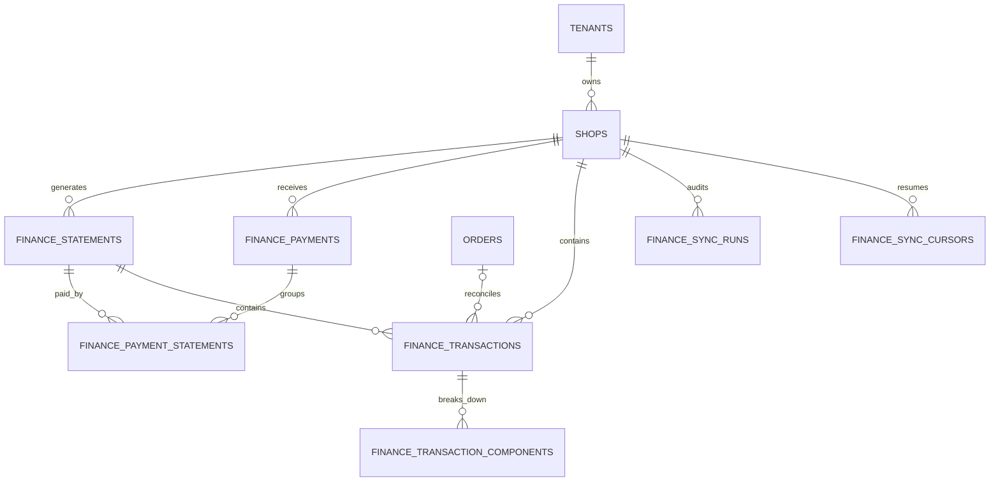

# ERP 财务板块开发计划书

> 编制日期：2026-08-21  
> 适用项目：`D:\codex\projects\erp-api`、`D:\codex\projects\erp-web`  
> 当前状态：Gate 0 已通过，尚未执行数据库、公共 API 或页面实现  
> 计划定位：TikTok Shop ERP 的结算、费用、付款与对账中心，不替代总账、报税或专业会计软件

已冻结的一期口径和真实能力探针结果见：

- [`finance-api-contract.md`](./finance-api-contract.md)
- [`tiktok-shop/finance-capability-report.md`](./tiktok-shop/finance-capability-report.md)

## 1. 结论与一期范围

当前 ERP 已有真实订单、订单行、店铺、联盟预估佣金、Dashboard 聚合和 ARQ 同步能力，但 `/finance` 仍是占位页。订单表只有销售额、运费、折扣、税和实付总额，Dashboard 的 `netSalesEstimated` 仍为估算状态；平台结算单、付款单、退款、平台费、调整项和银行到账尚未持久化。

因此一期应优先形成下面的只读财务闭环：

1. 从 TikTok Shop Finance API 同步结算单、付款单、已结算交易和未结算交易。
2. 将交易关联到现有 `orders`、`order_lines` 和 `shops`。
3. 展示销售收入、退款、平台费用、联盟佣金、物流费用、调整金额、结算金额和付款金额。
4. 对账“交易合计 → 结算单 → 平台付款”，识别缺失订单、金额差异、币种错误和重复数据。
5. 为财务总览、结算单、交易流水、付款和异常对账提供查询与 CSV 导出。
6. 所有金额按币种分别统计，所有估算值和最终值明确区分，不用订单状态猜算退款。

一期不做：

- 总账、会计科目、凭证、应收应付、发票、税务申报。
- 银行 Open Banking 直连和自动记账；一期只核对 TikTok 付款记录，二期再导入银行流水。
- 跨币种汇率换算和集团本位币报表。
- 完整商品成本与最终净利润。仓库模块仍是占位状态，缺少可审计的采购/入库成本来源。
- 人工修改平台原始金额。异常只能标记、备注或重新同步，原始事实不可覆盖。

## 2. 当前代码基线

| 能力            | 当前状态                                                                 | 财务模块处理                                    |
| --------------- | ------------------------------------------------------------------------ | ----------------------------------------------- |
| `/finance` 路由 | `route-metadata.tsx` 中为占位页                                          | 替换为财务总览，并增加子路由                    |
| 权限            | 前后端已有 `finance:view`                                                | 一期读取沿用；同步叠加 `sync:trigger`           |
| 订单数据        | 已有订单金额、状态、时间、店铺和订单行                                   | 作为财务交易的业务关联，不作为结算事实          |
| 联盟佣金        | 已有 `estimated_standard_commission`                                     | 仅作未结算估算；实际结算佣金优先                |
| Dashboard       | `netSalesEstimated=true`                                                 | 财务模块上线后再单独评估是否替换其数据源        |
| 数据库          | PostgreSQL + SQLAlchemy + Alembic，当前 migration head 为 `4e5f6a7b8c9d` | 实施前必须再次确认 head，再创建单一新 migration |
| 异步任务        | Redis + ARQ，已有订单/商品/Analytics 定时任务                            | 新增独立财务同步任务，不阻塞 API 请求           |
| 前端技术        | React 19、TypeScript 6、Ant Design 6、TanStack Query、ECharts            | 不需要新增一期运行时依赖                        |
| Git 状态        | 两个目录当前都不是 Git worktree                                          | 验证以源码检查、测试、构建和 Alembic 检查为准   |

## 3. 外部平台前置条件

TikTok Shop 官方 Finance API 当前提供 Statements、Payments、Transactions by Statement、Transactions by Order 和 Unsettled Transactions。Finance API 需要店铺授权范围 `seller.finance.info`；平台也明确区分未结算估算数据与结算单中的最终金额。

实施前必须通过真实授权店铺完成 Gate 0：

1. 在 Partner Center 确认应用已拥有 Finance Information / `seller.finance.info`。
2. 检查现有店铺授权 token 是否已经包含该 scope；缺失时必须由店铺重新授权，不能在后端绕过。
3. 使用安全探针确认当前店铺、区域和卖家类型可调用哪些 Finance API 版本。
4. 保存字段能力报告，不保存 token、签名、shop cipher、银行完整账号或原始敏感响应。
5. 如果某市场不支持 SKU 级交易，页面降级为订单级，明确显示数据粒度，不伪造 SKU 分摊。

官方参考：

- [Finance API overview](https://partner.tiktokshop.com/docv2/page/finance-api-overview)
- [Get Statements](https://partner.tiktokshop.com/docv2/page/get-statements)
- [Get Transactions by Statement](https://partner.tiktokshop.com/docv2/page/get-transactions-by-statement-202501)
- [Get Unsettled Transactions](https://partner.tiktokshop.com/docv2/page/get-unsettled-transactions-202507)
- [Access scope](https://partner.tiktokshop.com/docv2/page/access-scope)

## 4. 核心业务口径

### 4.1 金额口径

所有金额统一使用 `BigInteger` 最小货币单位和 ISO 4217 大写币种，不允许 `float`：

```text
grossRevenueMinor
+ sellerDiscountMinor
+ refundMinor
+ shippingAmountMinor
+ platformFeeMinor
+ affiliateCommissionMinor
+ taxAmountMinor
+ adjustmentAmountMinor
= settlementAmountMinor
```

注意：平台返回的扣减项通常为负数，归一化层必须保留符号。上式是归一化后的审计恒等式，不能按界面颜色或字段名称二次反转。

### 4.2 数据优先级

同一订单同一金额项只采用一个来源，避免重复计算：

1. 已结算 Finance transaction：最终事实。
2. 未结算 transaction：平台估算，必须标记 `estimated=true`。
3. 现有订单金额或联盟佣金：仅在 Finance 数据缺失时作为辅助估算。
4. 无可靠来源：返回 `null` 或 `unavailable`，不返回看似精确的 `0`。

### 4.3 时间和币种

- API 接收带时区 ISO 8601，后端转为 UTC，范围统一为左闭右开 `[from, to)`。
- 日期筛选按店铺时区生成 UTC 边界；数据库保存 UTC。
- 不同币种绝不合计。选择“全部币种”时返回按币种分组，不生成伪总计。
- 历史回填先执行最近 30 天，核对无误后再由用户批准更早窗口。

### 4.4 “利润”展示边界

一期可可靠展示：结算金额、费用、退款、付款和未到账金额。

一期不可可靠展示最终净利润，因为当前没有采购/入库成本。页面可以显示“结算贡献金额”，但不得显示“净利润”。二期接入商品成本后才增加：

```text
contributionProfitMinor = settlementAmountMinor - productCostMinor - externalOperatingCostMinor
marginBps = contributionProfitMinor * 10000 / comparableRevenueMinor
```

如果成本完整度不足，`contributionProfitMinor` 和 `marginBps` 必须返回 `null`，同时返回缺失原因。

## 5. 预计数据结构

### 5.1 实体关系



### 5.2 表设计

#### `finance_statements`

| 字段                                         | 类型                    | 说明                       |
| -------------------------------------------- | ----------------------- | -------------------------- |
| `id`                                         | UUID PK                 | ERP 内部 ID                |
| `tenant_id`, `shop_id`                       | UUID                    | 复合租户/店铺边界          |
| `platform_statement_id`                      | String(128)             | 平台结算单 ID              |
| `status`, `payment_status`                   | String(32)              | 归一化状态和付款状态       |
| `currency`                                   | String(3)               | ISO 4217                   |
| `revenue_amount_minor`                       | BigInteger              | 收入合计                   |
| `fee_amount_minor`                           | BigInteger              | 费用合计，保留符号         |
| `adjustment_amount_minor`                    | BigInteger              | 调整合计                   |
| `settlement_amount_minor`                    | BigInteger              | 最终结算金额               |
| `statement_start_at`, `statement_end_at`     | DateTime(timezone=True) | 结算周期                   |
| `platform_created_at`, `platform_updated_at` | DateTime(timezone=True) | 平台时间                   |
| `synced_at`                                  | DateTime(timezone=True) | ERP 同步时间               |
| `source_hash`                                | String(64)              | 去重与变更检测，不含敏感值 |

约束：`UNIQUE (tenant_id, shop_id, platform_statement_id)`；复合外键 `[shop_id, tenant_id] -> shops[id, tenant_id]`。

#### `finance_payments`

字段：`id`、`tenant_id`、`shop_id`、`platform_payment_id`、`status`、`currency`、`payment_amount_minor`、`initiated_at`、`paid_at`、`bank_reference_masked`、`platform_updated_at`、`synced_at`、`source_hash`。

约束：`UNIQUE (tenant_id, shop_id, platform_payment_id)`。不得保存完整银行账号；如平台只返回完整值，归一化时立即掩码。

#### `finance_payment_statements`

字段：`tenant_id`、`payment_id`、`statement_id`。使用联合主键，支持一个付款合并多个结算单，也避免假设一一关系。

#### `finance_transactions`

| 字段组 | 关键字段                                                                                                                                         |
| ------ | ------------------------------------------------------------------------------------------------------------------------------------------------ |
| 身份   | `id`, `tenant_id`, `shop_id`, `source_record_key`, `platform_transaction_id`                                                                     |
| 关联   | `statement_id` nullable, `order_id` nullable, `platform_order_id` nullable                                                                       |
| 分类   | `transaction_type`, `status`, `is_estimated`, `currency`                                                                                         |
| 金额   | `revenue_amount_minor`, `refund_amount_minor`, `shipping_amount_minor`, `fee_amount_minor`, `adjustment_amount_minor`, `settlement_amount_minor` |
| 时间   | `occurred_at`, `platform_updated_at`, `synced_at`                                                                                                |
| 审计   | `source_hash`, `data_completeness`                                                                                                               |

约束：`UNIQUE (tenant_id, shop_id, source_record_key)`。`source_record_key` 优先使用平台交易 ID；缺失时由稳定业务字段生成哈希，禁止使用分页游标作为身份。

#### `finance_transaction_components`

字段：`id`、`tenant_id`、`transaction_id`、`component_code`、`component_category`、`amount_minor`、`currency`、`platform_sku_id` nullable、`order_line_id` nullable、`description` nullable。

用途：保存平台佣金、联盟佣金、运费、税、补贴、退款、reserve、adjustment 等明细；未知平台 code 仍保存为 `unknown` 类别并保留原 code，不能导致整条响应失败。

#### `finance_sync_runs` 与 `finance_sync_cursors`

- `finance_sync_runs`：记录 `mode`、明确的 `from/to`、状态、获取/写入/跳过/失败/差异数量、开始/结束时间和安全错误摘要。
- `finance_sync_cursors`：按 `tenant_id + shop_id + entity_type` 唯一，保存 `recovery_cursor`、`committed_cursor`、`last_successful_at`。
- 每页成功后更新 recovery cursor；整个批次成功后才能提交 committed cursor。
- 状态沿用现有约定：`queued/running/retry_wait/succeeded/failed/dead_letter/cancelled`。

### 5.3 暂不建表的派生结构

`FinanceOverview` 和订单财务摘要一期直接由上述交易表聚合，不先创建物化汇总表。只有在代表性 10 万交易量下查询 p95 超过目标后，才评估 `finance_order_summaries` 读模型，避免过早引入双写一致性问题。

## 6. 内部 API 设计

所有响应继续使用现有 v1 契约、camelCase、`X-API-Contract-Version`、服务端分页和统一错误结构。

```text
GET  /api/finance/overview?shopId=&from=&to=&currency=
GET  /api/finance/statements?page=&pageSize=&shopId=&status=&from=&to=&currency=
GET  /api/finance/statements/{statementId}
GET  /api/finance/transactions?page=&pageSize=&shopId=&statementId=&orderId=&type=&status=&from=&to=&currency=
GET  /api/finance/payments?page=&pageSize=&shopId=&status=&from=&to=&currency=
GET  /api/finance/reconciliation?shopId=&from=&to=&currency=&status=
GET  /api/finance/orders/{orderId}/summary
GET  /api/finance/export?resource=&shopId=&from=&to=&currency=
POST /api/finance/sync
```

`POST /api/finance/sync` 请求必须有边界：

```json
{
  "shopId": "uuid",
  "mode": "backfill",
  "from": "2026-07-01T00:00:00Z",
  "to": "2026-08-01T00:00:00Z"
}
```

权限规则：

- 所有读取和 CSV 导出：`finance:view`。
- 同步：同时要求 `finance:view` 和现有 `sync:trigger`。
- 二期银行流水导入、人工匹配和备注：新增 `finance:manage`，不得复用只读权限。
- 所有查询必须经过 tenant session；传入其他租户 ID 时统一表现为资源不存在。

`FinanceOverview` 至少返回：

```ts
interface FinanceOverview {
  period: { from: string; to: string }
  currency: string
  basis: 'settled' | 'estimated' | 'mixed'
  grossRevenueMinor: number
  refundAmountMinor: number
  platformFeeMinor: number
  affiliateCommissionMinor: number
  shippingAmountMinor: number
  taxAmountMinor: number
  adjustmentAmountMinor: number
  settlementAmountMinor: number
  paidAmountMinor: number
  outstandingAmountMinor: number
  contributionProfitMinor: number | null
  marginBps: number | null
  completeness: 'complete' | 'partial' | 'unavailable'
  missingReasons: string[]
}
```

## 7. 前端页面设计

### 7.1 `/finance` 财务总览

页面结构：

1. 顶部筛选：店铺、日期、币种、结算口径、刷新按钮、导出按钮。
2. 数据状态条：最后同步时间、结算/估算口径、缺失 scope、同步失败和部分数据提示。
3. KPI 卡片：销售收入、退款、平台费用、联盟佣金、结算金额、已付款、待付款、对账差异。
4. 趋势图：收入、退款、费用、结算金额按日展示。
5. 费用构成图：平台费、联盟佣金、物流费、税、调整项。
6. 最近结算单表：结算周期、状态、金额、付款状态、差异、详情入口。
7. 对账异常表：缺失订单、金额不平、币种冲突、孤立付款、重复记录。

规则：估算 KPI 必须带“预计”标签；部分数据不得用绿色成功态；跨币种时按币种拆卡或要求选择单一币种。

### 7.2 `/finance/statements` 结算单

- 筛选：店铺、结算日期、付款状态、币种。
- 列：结算单号、周期、收入、费用、调整、结算金额、付款状态、交易数、差异状态。
- 点击进入 `/finance/statements/:statementId`。
- 详情页展示金额恒等式、关联付款、订单交易和组件明细；订单号链接到现有 `/orders/:orderId`。

### 7.3 `/finance/transactions` 财务流水

- 支持服务端分页和订单号/平台交易号搜索。
- 筛选：结算/未结算、交易类型、费用类别、日期、币种、店铺。
- 列：发生时间、订单、类型、收入、退款、费用、调整、结算金额、口径、结算单。
- 展开行查看 SKU/费用组件，不在列表请求中逐条请求详情，避免 N+1。

### 7.4 `/finance/payments` 平台付款

- 列：付款单号、发起时间、到账时间、状态、金额、关联结算单数、对账差异。
- 银行参考号只显示掩码。
- 一期的“已对账”表示平台付款金额与关联结算单一致，不代表已经核对真实银行流水。

### 7.5 `/finance/reconciliation` 对账中心

- 汇总四类异常：交易不等于结算单、结算单不等于付款、订单缺失、币种/重复异常。
- 支持按严重级别、状态和店铺过滤。
- 一期提供重新同步和 CSV 导出，不提供修改原始金额。
- 二期加入银行流水导入、人工匹配、备注、处理人和审计日志。

### 7.6 页面状态

所有页面必须覆盖：

- loading：`PageLoading` 或表格 skeleton。
- error：显示真实后端错误并提供重试，不静默回退 Mock。
- empty：区分“确实无数据”“未授权”“尚未同步”和“筛选无结果”。
- partial：页面可读，但显著标记数据不完整及缺失原因。
- unauthorized：路由权限转 `/403`，scope 缺失显示业务引导，不伪装成 403。

## 8. 执行步骤与文件清单

### 步骤 0：冻结口径和能力边界（0.5～1 人日）

做什么：确认一期只读范围、币种、时间口径、估算/最终优先级、首个真实店铺和 30 天验收窗口；完成 Finance scope 探针。

文件：

- 新增 `erp-web/docs/finance-api-contract.md`
- 新增 `erp-web/docs/tiktok-shop/finance-capability-report.md`
- 更新 `erp-web/docs/api-v1-contract.md`

验收：用户确认范围；真实店铺返回可用 API/版本/字段清单；没有记录凭据。

### 步骤 1：定义规范化 DTO 与 TikTok Finance 客户端（2～3 人日）

> 实施状态（2026-08-21）：已完成。严格 DTO/parser、五类只读客户端、已验证版本配置与 30 天窗口保护均已落地；数据库、同步、内部路由和前端骨架已在后续步骤 2～5 完成。

做什么：复用现有 `TikTokTransport` 的签名、重试、`Retry-After` 和安全错误映射；为 Statements、Payments、Statement Transactions、Order Transactions、Unsettled Transactions 定义严格解析器。

文件：

- 新增 `erp-api/src/erp_api/services/tiktok_finance_schemas.py`
- 新增 `erp-api/src/erp_api/services/tiktok_finance_client.py`
- 新增 `erp-api/tests/test_tiktok_finance_schemas.py`
- 新增 `erp-api/tests/test_tiktok_finance_client.py`
- 修改 `erp-api/src/erp_api/core/config.py`
- 修改后端 `*.env.example`，只增加 URL、窗口和 TTL 占位配置，不增加密钥

验收：金额只通过 `Decimal` 转最小单位；未知费用 code 可安全降级；429/5xx 重试行为与现有 transport 一致；日志无 token、签名和 shop cipher。

### 步骤 2：数据库模型与 migration（2 人日，实施前需用户批准 schema）

> 实施状态（2026-08-21）：已获用户批准并完成。六类领域结构落为 7 张物理表，migration `5f6a7b8c9d0e` 已通过 upgrade/downgrade/upgrade、`alembic check`、跨租户外键和幂等唯一约束实测。

做什么：创建第 5 节中的六类表，建立租户安全复合外键、唯一约束和常用筛选索引。

文件：

- 新增 `erp-api/src/erp_api/models/finance_statement.py`
- 新增 `erp-api/src/erp_api/models/finance_payment.py`
- 新增 `erp-api/src/erp_api/models/finance_transaction.py`
- 新增 `erp-api/src/erp_api/models/finance_transaction_component.py`
- 新增 `erp-api/src/erp_api/models/finance_sync.py`
- 修改 `erp-api/src/erp_api/models/__init__.py`
- 新增 `erp-api/migrations/versions/<revision>_create_finance_domain_tables.py`
- 新增 `erp-api/tests/test_finance_models.py`
- 新增 `erp-api/tests/test_finance_migration.py`

验收：`alembic check` 通过；upgrade/downgrade/upgrade 往返通过；跨租户外键插入失败；重复平台记录被唯一约束阻止。

### 步骤 3：幂等同步和审计（3～4 人日）

> 实施状态（2026-08-21）：后端实现与真实 30 天窗口验证已完成。已交付显式 backfill、24 小时重叠滚动增量、分实体 recovery/committed cursor、statement → transaction → payment 顺序、最终值覆盖估算值、同步审计、ARQ 日调度及受控订单明细并发。Akeleo Fun Toys 同一窗口重复同步后保持 32 statements、4 payments、276 transactions，重复 source key 为 0；Seller Center 金额人工抽样仍属于业务验收步骤。

做什么：实现显式窗口 backfill、滚动增量同步、分页恢复、statement → transaction → payment 依赖顺序和 ARQ 定时任务。已结算数据更新后覆盖估算口径，但保留同步审计。

文件：

- 新增 `erp-api/src/erp_api/services/finance_sync_repository.py`
- 新增 `erp-api/src/erp_api/services/finance_sync_service.py`
- 新增 `erp-api/src/erp_api/workers/finance_jobs.py`
- 修改 `erp-api/src/erp_api/workers/settings.py`
- 修改 `erp-api/src/erp_api/main.py`
- 新增 `erp-api/tests/test_finance_sync_repository.py`
- 新增 `erp-api/tests/test_finance_sync_service.py`
- 新增 `erp-api/tests/test_finance_jobs.py`
- 修改 `erp-api/tests/test_worker_settings.py`

验收：同一窗口重复同步不增加重复行；中途失败可从 recovery cursor 恢复；完整批次失败不推进 committed cursor；死信可观测；最近 30 天同步结果能与 Seller Center 抽样核对。

### 步骤 4：财务查询、对账和内部 API（2～3 人日）

> 实施状态（2026-08-21）：后端已完成并通过真实库验收。已注册 10 个 `/api/finance` 路由，覆盖按币种拆分的总览、结算单/交易/付款服务端分页、结算单与交易详情、订单财务摘要、交易/结算单/付款三层差异、三类资源 CSV 流式导出和手工同步入口。交易恒等式不重复计入退款拆分项；所有读取/导出要求 `finance:view`，同步同时要求 `sync:trigger`。当前真实库验收为 32 statements、4 payments、276 transactions；`549 passed`、changed-file Ruff、`alembic check` 和 OpenAPI 路由检查均通过。平台付款目前未提供可验证的 statement ID 映射，系统按孤立付款/币种差异如实暴露，不进行时间或金额猜测匹配。

做什么：实现总览聚合、列表分页、详情、订单关联、金额恒等式、付款/结算差异和 CSV 流式导出。

文件：

- 新增 `erp-api/src/erp_api/services/finance_repository.py`
- 新增 `erp-api/src/erp_api/services/finance_reconciliation.py`
- 新增 `erp-api/src/erp_api/services/finance_repository_queries.py`
- 新增 `erp-api/src/erp_api/services/finance_transaction_repository.py`
- 新增 `erp-api/src/erp_api/services/finance_overview_repository.py`
- 新增 `erp-api/src/erp_api/services/finance_reconciliation_repository.py`
- 新增 `erp-api/src/erp_api/services/finance_export.py`
- 新增 `erp-api/src/erp_api/services/finance_export_repository.py`
- 新增 `erp-api/src/erp_api/routers/finance_schemas.py`
- 新增 `erp-api/src/erp_api/routers/finance_response.py`
- 新增 `erp-api/src/erp_api/routers/finance.py`
- 修改 `erp-api/src/erp_api/main.py`
- 新增 `erp-api/tests/test_finance_repository.py`
- 新增 `erp-api/tests/test_finance_reconciliation.py`
- 新增 `erp-api/tests/test_finance_routes.py`
- 新增 `erp-api/tests/test_finance_export.py`
- 新增 `erp-api/tests/test_finance_sync_routes.py`

验收：所有端点要求 `finance:view`；同步额外要求 `sync:trigger`；分页/筛选进入 SQL；导出遵循相同过滤；任何租户都不能看到其他租户记录。

### 步骤 5：前端模块骨架与真实 API（1.5～2 人日）

> 实施状态（2026-08-21）：已完成。Finance 已建立 `types/api/queries/pages` 分层，接入步骤 4 的 10 个真实后端路由，列表、详情、对账、订单摘要、导出和同步均有类型化调用及独立 Query Key；`VITE_FINANCE_USE_MOCK` 只有显式为 `true` 时才使用本地 fixture，真实错误不回退 Mock。`/finance` 已从通用占位页切换为受 `finance:view` 保护的懒加载财务总览。

做什么：建立 finance feature 分层、Query Key、类型、真实 API 和显式 Mock 边界；替换占位路由。

文件：

- 新增 `erp-web/src/features/finance/types/finance.types.ts`
- 新增 `erp-web/src/features/finance/api/finance.api.ts`
- 新增 `erp-web/src/features/finance/api/mock-finance-api.ts`
- 新增 `erp-web/src/features/finance/api/finance.api.test.ts`
- 新增 `erp-web/src/features/finance/queries/finance.queries.ts`
- 新增 `erp-web/src/features/finance/queries/finance.queries.test.tsx`
- 新增 `erp-web/src/features/finance/pages/finance-module-page.tsx`
- 修改 `erp-web/src/services/api-mode.ts`
- 修改 `erp-web/.env.example`，增加 `VITE_FINANCE_USE_MOCK=false`
- 修改 `erp-web/src/auth/permission-codes.ts`
- 修改 `erp-web/src/router/route-pages.tsx`
- 修改 `erp-web/src/router/route-metadata.tsx`
- 新增 `erp-web/src/router/finance-route.test.tsx`

验收：Finance Mock 只能显式设为 `true`；真实 API 失败保持可见；所有筛选参数都进入 Query Key；无权限不能看到菜单或访问页面。

### 步骤 6：财务总览页面（2～3 人日）

> 实施状态（2026-08-21）：已完成。页面支持店铺、最多 30 天日期、币种和最终/估算口径筛选；日期按店铺时区转换为 UTC 左闭右开窗口。已实现 8 个 KPI、收入/退款/费用/结算日趋势、费用构成、最近 5 张结算单、CSV 导出，以及完整/部分/不可用和对账差异提示。后端 `/finance/overview` 已补充 `isEstimated` 过滤及按 UTC 自然日的严格 SQL 趋势聚合，未从分页明细近似计算趋势。真实 API 错误保持可见，Mock 仍只允许显式开启。

做什么：完成筛选、KPI、趋势、费用构成、最近结算单和数据完整度提示。

文件：

- 新增 `erp-web/src/features/finance/pages/finance-overview-page.tsx`
- 新增 `erp-web/src/features/finance/components/finance-filters.tsx`
- 新增 `erp-web/src/features/finance/components/finance-kpi-cards.tsx`
- 新增 `erp-web/src/features/finance/components/finance-trend-chart.tsx`
- 新增 `erp-web/src/features/finance/components/finance-fee-chart.tsx`
- 新增 `erp-web/src/features/finance/components/finance-status-banner.tsx`
- 新增 `erp-web/src/features/finance/components/finance-format.ts`
- 新增 `erp-web/src/features/finance/pages/finance-page.css`
- 为格式化、图表数据转换和页面状态新增相邻测试文件

验收：金额格式与币种一致；估算和最终值视觉可区分；响应式宽度可用；空/错/部分/正常状态都有测试。

### 步骤 7：明细与对账页面（3～4 人日）

> 实施状态（2026-08-21）：已完成。新增结算单、流水、付款、对账四类列表和结算单详情页，并统一挂载到 `finance:view` 权限路由。结算单、流水和付款严格使用后端 `page/pageSize` 分页；对账遵循现有公共 API 的最多 100 条异常快照边界，并在页面显式说明后做当前快照内的类型/严重度筛选。结算单详情展示金额恒等式、流水合计和付款差异，复用同一组表格组件；流水中的订单链接直接使用后端 `orderPath` 进入现有 `/orders/:orderId`，不新增平行订单详情。银行参考仅展示 `bankReferenceMasked`。

做什么：实现结算单、流水、付款、对账列表和结算单详情；订单链接复用现有订单详情。

文件：

- 新增 `erp-web/src/features/finance/pages/finance-statements-page.tsx`
- 新增 `erp-web/src/features/finance/pages/finance-statement-detail-page.tsx`
- 新增 `erp-web/src/features/finance/pages/finance-transactions-page.tsx`
- 新增 `erp-web/src/features/finance/pages/finance-payments-page.tsx`
- 新增 `erp-web/src/features/finance/pages/finance-reconciliation-page.tsx`
- 新增 `erp-web/src/features/finance/components/finance-statement-table.tsx`
- 新增 `erp-web/src/features/finance/components/finance-transaction-table.tsx`
- 新增 `erp-web/src/features/finance/components/finance-payment-table.tsx`
- 新增 `erp-web/src/features/finance/components/finance-reconciliation-table.tsx`
- 增加相邻组件/页面测试

验收：列表均为服务端分页；不产生逐行详情 N+1；筛选可刷新/回退；订单和结算单跳转正确；银行参考只显示掩码。

### 步骤 8：端到端验证与性能安全检查（2～3 人日）

做什么：覆盖真实 PostgreSQL/Redis/API/Worker 前置，执行全量回归、权限、租户隔离、重试、导出和浏览器验收。

文件：

- 新增 `erp-web/tests/e2e/finance.spec.ts`
- 更新 `erp-web/tests/e2e/session_setup.py`
- 视需要补充 `erp-api/scripts/check_no_secrets.py` 的财务敏感字段模式

验证命令：

```powershell
# Backend
& .\.venv\Scripts\python.exe -m pytest -q -p no:cacheprovider
& .\.venv\Scripts\python.exe -m compileall -q src migrations scripts app backend
& .\.venv\Scripts\alembic.exe check
& .\.venv\Scripts\python.exe scripts\check_no_secrets.py --all

# Frontend
npm run format:check
npm run lint:types
npm run test
npm run build
npm run test:e2e -- finance.spec.ts
```

验收：全量回归通过；无真实凭据进入日志/响应/前端；代表性 10 万交易数据下总览 p95 小于 800ms、列表 p95 小于 500ms；CSV 导出有行数上限且不占满内存。

2026-08-21 执行结果：功能与安全回归已完成。后端全量 `550 passed`，权限、租户隔离、TikTok 重试、Worker、Finance 同步与 CSV 导出专项 `68 passed`；前端单元/组件测试 `146 passed`，真实模式 Playwright 全套 `5 passed`。真实 PostgreSQL、Redis、最新 API 与 ARQ Worker 均通过健康探针，E2E 隔离租户清理后残留为 0。详细证据见 `docs/tiktok-shop/finance-development-status.md`。10 万交易性能压测仍需单独执行，不包含在本次功能验收结论中。

### 步骤 9：灰度与历史回填（1～2 人日，不含平台审批等待）

做什么：只对测试店铺启用；先同步最近 30 天；抽样核对 Seller Center；确认差异原因后再批准更早窗口；最后扩展到全部店铺。

文件：

- 新增 `erp-web/docs/tiktok-shop/finance-development-status.md`
- 更新两个项目的 `README.md`
- 更新部署环境模板，不写入真实值

验收：30 天窗口的 statement/payment/transaction 数量与金额可解释；无高优先级对账差异；后台失败不会让前端回退 Mock；用户批准后才执行更早历史回填。

## 9. 依赖清单

### 9.1 现有依赖，可直接复用

后端：FastAPI、Pydantic Settings、SQLAlchemy async、asyncpg、Alembic、Redis、ARQ、httpx、cryptography、pytest、ruff。

前端：React、TypeScript、Vite、Ant Design、TanStack Query、Axios、ECharts、Day.js、Vitest、Testing Library、Playwright。

基础设施：PostgreSQL、Redis、API 进程、ARQ Worker、现有 TikTok OAuth/签名传输。

### 9.2 一期不建议新增的依赖

- 不引入 pandas：聚合交给 SQL，CSV 使用 Python 标准库流式输出。
- 不引入 Excel 库：一期先交付 CSV，明确需要 `.xlsx` 时再评估 `openpyxl`。
- 不引入新任务队列：沿用 ARQ。
- 不引入前端状态库：服务端状态沿用 TanStack Query，筛选用局部状态。
- 不引入第三方图表库：沿用 ECharts。

### 9.3 预计新增配置

```text
TIKTOK_FINANCE_STATEMENTS_URL
TIKTOK_FINANCE_PAYMENTS_URL
TIKTOK_FINANCE_STATEMENT_TRANSACTIONS_URL
TIKTOK_FINANCE_ORDER_TRANSACTIONS_URL
TIKTOK_FINANCE_UNSETTLED_TRANSACTIONS_URL
TIKTOK_FINANCE_SYNC_LOOKBACK_DAYS=30
TIKTOK_FINANCE_RAW_PAYLOAD_TTL_DAYS=90
FINANCE_EXPORT_MAX_ROWS=100000
VITE_FINANCE_USE_MOCK=false
```

这些配置只包含端点和运行参数。现有 App Secret、店铺 token 和加密材料继续由后端安全边界持有，不增加任何 `VITE_*` 密钥。

## 10. 测试矩阵

| 层级           | 必测内容                                                                 |
| -------------- | ------------------------------------------------------------------------ |
| Schema         | 金额字符串、负值、未知费用类型、缺字段、不同币种、时间解析               |
| Model          | 唯一约束、租户复合外键、级联、nullable 关联                              |
| Repository     | SQL 前置筛选、分页 total、金额聚合、订单关联、币种隔离                   |
| Sync           | 幂等、分页恢复、重试、死信、估算转已结算、乱序更新                       |
| Reconciliation | 金额相等、1 个最小单位舍入差、缺订单、孤立付款、重复交易                 |
| API            | 401/403/404/422/429/502、camelCase、统一 envelope、导出过滤一致          |
| Frontend       | Query Key、金额格式、loading/error/empty/partial、权限路由、无 Mock 回退 |
| E2E            | 登录、店铺筛选、总览、结算详情、订单跳转、导出、无权限用户               |
| Security       | 跨租户访问、敏感字段掩码、日志清理、凭据扫描、导出权限                   |

## 11. 风险与应对

| 风险                                   | 影响                   | 应对                                                       |
| -------------------------------------- | ---------------------- | ---------------------------------------------------------- |
| Finance scope 未获批或旧授权缺少 scope | 无法真实同步           | Gate 0 先验证，必要时重新授权，不绕过                      |
| 不同市场字段/API 版本不同              | DTO 解析失败或数据缺列 | 能力报告 + 归一化层 + `dataCompleteness`                   |
| 未结算金额后续变化                     | 页面金额前后不一致     | 明确 estimated；滚动重拉；结算后以 statement 为准          |
| 平台费用类型持续扩展                   | 新 code 导致同步中断   | 保留原 code，未知类型归 `unknown` 并告警                   |
| 同一 payment 合并多个 statement        | 一对一模型错误         | 使用 `finance_payment_statements` 多对多关联               |
| 佣金重复计算                           | 结算金额偏低           | 实际 Finance 佣金优先，联盟估算只作缺失回退                |
| 无商品成本却展示利润                   | 误导经营决策           | 一期只显示结算/贡献金额；利润字段可空并说明原因            |
| 大量交易拖慢页面                       | 总览或列表超时         | SQL 聚合、复合索引、服务端分页、禁止 N+1、性能门槛         |
| 财务数据泄露                           | 高安全风险             | tenant scope、后端 token、银行掩码、最小导出权限、安全日志 |

## 12. 里程碑与预估

按 1 名熟悉当前项目的开发者估算，不包含 TikTok scope 审批和店铺重新授权等待：

| 里程碑 | 内容                             |        预计 |
| ------ | -------------------------------- | ----------: |
| M0     | 能力验证、口径与契约冻结         |   1～2 人日 |
| M1     | DTO、客户端、数据模型、migration |   4～5 人日 |
| M2     | 同步、存储、查询、对账 API       |   5～7 人日 |
| M3     | 总览、明细、付款、对账前端       |   5～7 人日 |
| M4     | 全量测试、性能、安全、30 天灰度  |   3～4 人日 |
| 合计   | 一期只读财务闭环                 | 18～25 人日 |

二期“银行流水导入 + 人工对账 + 成本与贡献利润”预计另需 8～12 人日，开始前需要单独确认数据来源、权限、数据库 schema 和审计要求。

## 13. 开始实施前的三个批准点

1. 确认一期产品范围采用本计划的“结算与对账中心”，不包含总账和报税。
2. 确认允许新增第 5 节的数据库表和第 6 节的内部公共 API。
3. 确认首个灰度店铺、`seller.finance.info` 授权状态，以及最近 30 天的首次真实同步窗口。

完成这三个批准点后，开发应严格按“Gate 0 → 后端事实层 → 前端展示层 → 30 天灰度”的顺序推进；任何真实模式错误保持可见，不静默使用 Mock 数据。
