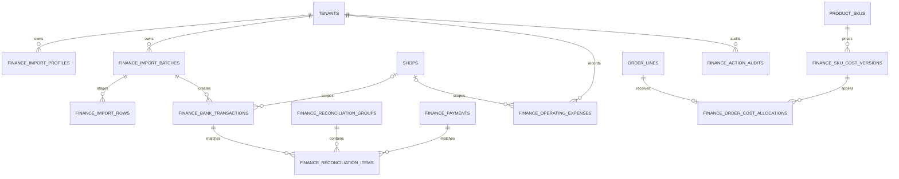

# ERP 财务板块第二期开发计划书

> 编制日期：2026-08-21  
> 适用项目：`D:\codex\projects\erp-api`、`D:\codex\projects\erp-web`  
> 前置文档：[`finance-module-development-plan.md`](./finance-module-development-plan.md)  
> 当前状态：独立规划完成，尚未执行数据库、公共 API 或业务代码变更  
> 计划定位：在第一期平台结算闭环之上，建设银行流水核对、SKU 标准成本、经营费用和贡献利润能力

## 1. 前置条件与结论

截至本计划编制时，第一期财务模块仍只有计划书，尚未实现。因此第二期不能直接开工，必须先满足以下条件：

1. 第一期 `finance_statements`、`finance_payments`、`finance_transactions` 和财务同步链路已经实现。
2. 最近 30 天真实结算数据已与 TikTok Shop Seller Center 完成验收。
3. 平台付款与结算单的内部对账没有未解释的高优先级差异。
4. 第一期开启真实 API 模式，失败保持可见，没有静默回退 Mock。
5. 第二期新增权限、数据库表和写 API 已获得用户批准。

第二期的目标不是建设完整会计系统，而是形成可审计的经营核算闭环：

```text
TikTok 交易与结算
        ↓
TikTok 平台付款
        ↓
银行流水到账核对

订单行 × 生效的 SKU 标准成本
        +
可分配的经营费用
        ↓
贡献利润与完整度
```

## 2. 第二期范围

### 2.1 Phase 2A：核心闭环

1. 银行 CSV 导入、列映射、预览、校验、去重和正式入库。
2. 银行流水与第一期 `finance_payments` 的一对一自动匹配建议。
3. 人工确认匹配、撤销匹配、忽略流水和处理备注。
4. SKU 标准成本 CSV 导入、草稿校验、版本发布和生效日期管理。
5. 将标准成本分配到订单行，计算订单、SKU、店铺维度的贡献利润。
6. 展示银行到账率、成本覆盖率、贡献利润和数据完整度。

### 2.2 Phase 2B：增强能力

1. 一对多、多对一和多对多银行匹配。
2. 经营费用录入/导入及按订单数、销量、收入或指定店铺分配。
3. 退款订单的成本处理状态和人工调整。
4. 成本发布、银行匹配、费用修改和敏感导出的审计日志。
5. 利润异常、负毛利 SKU、缺失成本和未匹配到账的专项报表。

### 2.3 明确不做

- 不建设仓库、采购、入库、批次库存、移动加权成本或 FIFO。
- 不把标准成本称为真实库存成本，也不修改仓库占位路由。
- 不直接连接银行，不存储网银凭据，不发起付款或转账。
- 不建设会计科目、借贷记账、会计凭证、应收应付或税务申报。
- 不自动进行跨币种换算。
- 不允许修改 TikTok 原始交易、结算单或付款金额。
- 不把“银行已到账”与“订单有利润”混为一个状态。

## 3. 关键核算口径

### 3.1 名词定义

| 名称         | 定义                                                  |
| ------------ | ----------------------------------------------------- |
| 平台付款     | 第一期从 TikTok Finance API 获取的 `finance_payments` |
| 银行流水     | 用户上传的银行账单中的实际入账或出账记录              |
| 银行匹配     | 一个或多个平台付款与一个或多个银行流水建立可撤销关联  |
| SKU 标准成本 | 用户提供、带生效日期和版本的管理核算单位成本          |
| 订单成本     | 订单行数量乘以订单发生时生效的 SKU 标准成本           |
| 经营费用     | 不在 TikTok 结算金额内、由用户录入的管理核算费用      |
| 贡献利润     | 平台结算贡献减去订单成本和已分配经营费用              |
| 完整度       | 结算、成本、费用和退款成本处理是否具备可靠数据        |

### 3.2 银行对账口径

银行匹配首先要求：

- 同一租户。
- 同一币种。
- 银行流水方向与平台付款方向一致。
- 金额相等或在用户明确配置的最小单位容差内。
- 入账日期位于平台付款日期的允许窗口内。

匹配评分建议：

| 信号                               | 分值 |
| ---------------------------------- | ---: |
| 金额精确一致                       |   60 |
| 银行参考号包含平台付款号或稳定尾号 |   25 |
| 日期位于预计到账窗口               |   15 |

Phase 2A 只生成匹配建议，必须由拥有 `finance:manage` 的用户确认。Phase 2B 才允许对高置信度、规则固定的一对一记录启用自动确认，而且必须可配置、可撤销、可审计。

### 3.3 成本口径

标准成本按 `tenant + shop（可空）+ productSku + currency + effectiveFrom` 选择：

1. 优先选择指定店铺的已发布成本。
2. 没有店铺成本时可回退租户级已发布成本。
3. 订单日期使用 `paid_at`，缺失时回退 `placed_at`。
4. 已发布成本不可原地覆盖；修正必须发布新版本。
5. 同一作用域、SKU、币种的生效区间不得重叠。
6. 缺失成本返回 `missing`，不能按 `0` 参与利润计算。

标准单位成本：

```text
unitStandardCostMinor =
    purchaseCostMinor
  + packagingCostMinor
  + inboundFreightMinor
  + dutyCostMinor
  + otherUnitCostMinor
```

订单成本：

```text
orderLineCostMinor = unitStandardCostMinor * quantity
orderCostMinor = sum(orderLineCostMinor)
```

### 3.4 贡献利润口径

第一期已经将平台收入、退款、平台费用、佣金、物流费用、税和调整归入 `settlementAmountMinor`。第二期不重复扣减这些项目：

```text
contributionProfitMinor =
    orderSettlementAmountMinor
  - orderCostMinor
  - allocatedOperatingExpenseMinor
```

```text
contributionMarginBps =
    contributionProfitMinor * 10000 / comparableRevenueMinor
```

规则：

- 只有同币种金额可以相加减。
- `comparableRevenueMinor <= 0` 时，利润率返回 `null`。
- 未结算订单可以显示预计贡献利润，但必须标记 `estimated=true`。
- 退款订单如果无法确认商品是否退回、报废或仍可销售，不能自动冲回订单成本；完整度标记为 `partial`。
- 银行入账差异不直接计入利润。只有被明确分类为银行费用或汇兑损益的经营费用才能进入利润。
- 名称统一为“贡献利润”或“管理核算利润”，不得标记为财务报表净利润。

### 3.5 经营费用分配

支持以下方法：

- `direct`：直接关联店铺、订单或 SKU。
- `revenue_ratio`：在同店铺、同币种、同期间按可比收入占比分配。
- `order_count_ratio`：按订单数量分配。
- `sales_volume_ratio`：按销售件数分配。
- `unallocated`：仅进入费用总额，不进入订单/SKU 利润。

全局费用默认 `unallocated`。没有用户确认分配方法时，系统不得自行分摊。

## 4. 数据结构设计

### 4.1 实体关系



### 4.2 `finance_import_profiles`

保存可复用的银行或成本 CSV 映射规则。

| 字段                                     | 类型                 | 说明                               |
| ---------------------------------------- | -------------------- | ---------------------------------- |
| `id`, `tenant_id`                        | UUID                 | 租户边界                           |
| `profile_type`                           | String(32)           | `bank_statement` 或 `sku_cost`     |
| `name`                                   | String(128)          | 用户可识别名称                     |
| `bank_code`                              | String(64), nullable | 银行模板标识，不是凭据             |
| `delimiter`, `encoding`, `date_format`   | String               | CSV 解析规则                       |
| `timezone`                               | String(64)           | 无时区日期的解释时区               |
| `column_mapping`                         | JSONB                | 仅保存列名映射，不保存导入数据     |
| `amount_mode`                            | String(32)           | `signed` 或 `debit_credit_columns` |
| `default_currency`                       | String(3), nullable  | 文件缺少币种列时使用               |
| `created_by`, `created_at`, `updated_at` | UUID/DateTime        | 审计字段                           |

约束：`UNIQUE (tenant_id, profile_type, name)`。

### 4.3 `finance_import_batches`

字段：`id`、`tenant_id`、`profile_id`、`import_type`、`status`、`original_filename`、`file_sha256`、`file_size_bytes`、`total_rows`、`valid_rows`、`invalid_rows`、`duplicate_rows`、`committed_rows`、`uploaded_by`、`uploaded_at`、`committed_at`、`expires_at`、`safe_error_summary`。

状态：`uploaded/parsing/preview_ready/committing/succeeded/failed/expired/cancelled`。

约束：同租户、同导入类型、同文件哈希不得重复成功提交。原文件默认不落盘，只保存哈希、文件名和解析结果。

### 4.4 `finance_import_rows`

用于两阶段“预览 → 提交”，暂存标准化后的安全字段：

- `id`、`tenant_id`、`batch_id`、`row_number`。
- `row_status`：`valid/invalid/duplicate`。
- `normalized_payload`：仅允许白名单字段，不包含完整银行账号。
- `validation_errors`：稳定错误 code 和列号，不保存堆栈。
- 银行描述、对方名称和参考信息使用独立财务密钥加密或只保存掩码。
- 未提交/失败批次默认 7 天清理；成功提交后清理 staging rows。

### 4.5 `finance_bank_transactions`

| 字段组 | 字段                                                                                |
| ------ | ----------------------------------------------------------------------------------- |
| 身份   | `id`, `tenant_id`, `shop_id` nullable, `import_batch_id`, `source_record_key`       |
| 账户   | `account_fingerprint`, `account_masked`                                             |
| 金额   | `amount_minor`（入账为正、出账为负）, `currency`                                    |
| 时间   | `posted_at`, `value_at` nullable                                                    |
| 参考   | `bank_transaction_id` nullable, `reference_masked`, `reference_ciphertext` nullable |
| 对方   | `counterparty_masked`, `counterparty_ciphertext` nullable                           |
| 状态   | `reconciliation_status`, `ignored_reason` nullable                                  |
| 审计   | `created_at`, `created_by`, `source_hash`                                           |

约束：`UNIQUE (tenant_id, account_fingerprint, source_record_key)`。`source_record_key` 优先使用银行交易 ID，缺失时使用稳定标准化字段生成哈希。

### 4.6 `finance_reconciliation_groups` 与 `finance_reconciliation_items`

`finance_reconciliation_groups`：

- `id`、`tenant_id`、`currency`。
- `match_type`：`one_to_one/one_to_many/many_to_one/many_to_many`。
- `match_method`：`suggested/manual/automatic`。
- `status`：`suggested/matched/partially_matched/reversed`。
- `bank_total_minor`、`payment_total_minor`、`difference_minor`。
- `confidence_score`、`note`、`confirmed_by/at`、`reversed_by/at/reason`。

`finance_reconciliation_items`：

- `id`、`tenant_id`、`group_id`。
- `item_type`：`bank_transaction` 或 `finance_payment`。
- `bank_transaction_id` nullable、`finance_payment_id` nullable。
- `allocated_amount_minor`。

数据库约束保证两种实体只能填写一个。撤销采用状态变化，不物理删除历史匹配。

### 4.7 `finance_sku_cost_versions`

| 字段                                      | 说明                             |
| ----------------------------------------- | -------------------------------- |
| `id`, `tenant_id`, `shop_id` nullable     | 作用域                           |
| `product_sku_id`                          | 关联现有 `product_skus`          |
| `seller_sku_snapshot`                     | 保留导入时 SKU 便于审计          |
| `currency`                                | 成本币种                         |
| 五类单位成本字段                          | 采购、包装、入库运费、关税、其他 |
| `total_unit_cost_minor`                   | 后端计算，不信任前端合计         |
| `effective_from`, `effective_to` nullable | 生效区间                         |
| `status`                                  | `draft/published/retired`        |
| `source`、`import_batch_id` nullable      | `manual/csv` 及来源批次          |
| `created_by/at`, `published_by/at`        | 审计字段                         |

发布后金额和生效日期不可直接修改；更正时创建新版本并关闭旧区间。

### 4.8 `finance_order_cost_allocations`

字段：`id`、`tenant_id`、`order_id`、`order_line_id`、`sku_cost_version_id` nullable、`quantity`、`unit_cost_minor` nullable、`total_cost_minor` nullable、`currency` nullable、`cost_status`、`cost_basis_at`、`allocated_at`、`allocation_run_id`。

约束：当前有效分配 `UNIQUE (tenant_id, order_line_id)`。缺少成本时仍建立 `cost_status=missing` 记录，金额保持 `null`。

### 4.9 `finance_operating_expenses`

字段：`id`、`tenant_id`、`shop_id` nullable、`expense_date`、`period_from/to` nullable、`category`、`amount_minor`、`currency`、`allocation_method`、`order_id` nullable、`product_sku_id` nullable、`description`、`status`、`source`、`import_batch_id` nullable、`created_by/at`、`voided_by/at/reason`。

费用只能 `active` 或 `voided`，不物理删除。负数用于费用冲销，并必须关联被冲销记录或填写原因。

### 4.10 `finance_action_audits`

记录财务写操作：`action`、`entity_type/id`、`actor_user_id`、`request_id`、`occurred_at`、`before_hash`、`after_hash`、`safe_summary`。不保存 token、完整银行字段、原始 CSV 或前端提交的任意 JSON。

## 5. 内部 API 设计

### 5.1 导入

```text
GET  /api/finance/import-profiles?type=
POST /api/finance/import-profiles
PATCH /api/finance/import-profiles/{profileId}

POST /api/finance/imports/preview              # multipart CSV + mapping/profile
GET  /api/finance/imports/{batchId}
GET  /api/finance/imports/{batchId}/rows?page=&pageSize=&status=
POST /api/finance/imports/{batchId}/commit
POST /api/finance/imports/{batchId}/cancel
```

上传限制建议：仅 `.csv`；最大 20 MiB；最大 100,000 行；拒绝 NUL 字节、超长单元格和不一致列数。文件名只作展示，不能拼接本地路径。

### 5.2 银行流水与匹配

```text
GET  /api/finance/bank-transactions?page=&pageSize=&account=&status=&from=&to=&currency=
POST /api/finance/reconciliation/suggestions
GET  /api/finance/reconciliation/suggestions?page=&pageSize=&status=
POST /api/finance/reconciliation/groups
POST /api/finance/reconciliation/groups/{groupId}/confirm
POST /api/finance/reconciliation/groups/{groupId}/reverse
POST /api/finance/bank-transactions/{transactionId}/ignore
```

建议生成放在后端，前端不能提交可信 `confidenceScore` 或自行认定已匹配。

### 5.3 SKU 成本

```text
GET  /api/finance/sku-costs?page=&pageSize=&shopId=&keyword=&status=&effectiveAt=
POST /api/finance/sku-costs
PATCH /api/finance/sku-costs/{costVersionId}     # 仅 draft
POST /api/finance/sku-costs/{costVersionId}/publish
POST /api/finance/sku-costs/{costVersionId}/retire
GET  /api/finance/cost-coverage?shopId=&from=&to=&currency=
POST /api/finance/cost-allocation-runs
GET  /api/finance/cost-allocation-runs/{runId}
```

批量成本沿用通用 import API，`importType=sku_cost`。

### 5.4 经营费用与利润

```text
GET  /api/finance/expenses?page=&pageSize=&shopId=&category=&from=&to=&currency=&status=
POST /api/finance/expenses
PATCH /api/finance/expenses/{expenseId}           # 仅未被核算任务锁定的 active 记录
POST /api/finance/expenses/{expenseId}/void

GET  /api/finance/profit/overview?shopId=&from=&to=&currency=&basis=
GET  /api/finance/profit/trend?shopId=&from=&to=&currency=&granularity=
GET  /api/finance/profit/products?page=&pageSize=&shopId=&from=&to=&currency=&sortBy=
GET  /api/finance/profit/orders?page=&pageSize=&shopId=&from=&to=&currency=&completeness=
GET  /api/finance/audit-logs?page=&pageSize=&action=&actor=&from=&to=
```

### 5.5 权限

| 权限             | 能力                                                 |
| ---------------- | ---------------------------------------------------- |
| `finance:view`   | 查看利润、成本覆盖、银行流水掩码、匹配状态和审计摘要 |
| `finance:manage` | 上传、提交导入、发布成本、录入费用、确认/撤销匹配    |
| `finance:export` | 导出银行流水、成本、利润和审计报表                   |
| `sync:trigger`   | 仅用于第一期 TikTok Finance 同步，不替代二期管理权限 |

`finance:manage` 和 `finance:export` 是新增权限，修改权限枚举、bootstrap 和数据库前必须再次获得批准。

## 6. 前端页面设计

所有二期页面属于财务模块内部导航，不增加新的顶部一级菜单。

### 6.1 `/finance/profit` 贡献利润

页面结构：

1. 筛选：店铺、日期、币种、已结算/预计口径、成本完整度。
2. 数据质量条：结算覆盖率、成本覆盖率、费用分配率、退款成本待确认数。
3. KPI：可比收入、平台结算贡献、订单成本、经营费用、贡献利润、贡献利润率。
4. 趋势：结算贡献、成本、费用和贡献利润。
5. SKU 利润榜：销量、结算贡献、单位成本、总成本、贡献利润、利润率、完整度。
6. 订单利润表：订单、店铺、结算口径、成本、费用、贡献利润、缺失原因。

规则：完整度不足时利润 KPI 显示 `--` 或“部分数据”，不得把缺失成本当作零成本。

### 6.2 `/finance/costs` SKU 成本中心

- 顶部显示成本覆盖率和缺失成本 SKU 数。
- 列表展示 SKU、商品、作用店铺、币种、成本构成、生效区间、状态和来源。
- 支持新建草稿、CSV 导入、预览差异、发布和停用。
- 发布前显示受影响订单数和日期范围。
- 已发布记录只读；更正操作创建新版本。

### 6.3 `/finance/imports` 导入中心

采用四步向导：

1. 上传 CSV。
2. 选择/配置列映射、编码、日期格式、金额模式和默认币种。
3. 预览有效、错误和重复行；错误定位到行号与列名。
4. 提交后台任务并查看成功、跳过、失败数量。

导入类型切换：银行流水、SKU 成本、经营费用。页面不显示原始完整银行账号。

### 6.4 `/finance/bank-transactions` 银行流水

- 筛选：账户掩码、日期、币种、入/出账、匹配状态。
- 列：入账日期、金额、账户掩码、参考掩码、对方掩码、匹配状态、来源批次。
- 详情抽屉显示允许查看的解密字段，并记录敏感访问审计；默认仍显示掩码。
- 支持进入匹配工作台、忽略记录和查看处理历史。

### 6.5 `/finance/reconciliation/workbench` 银行对账工作台

布局：

- 左侧：未匹配银行流水。
- 右侧：候选平台付款。
- 中间：评分依据、金额差异、日期差异和参考号命中。
- 底部：确认匹配、部分匹配、组合匹配、忽略、撤销和备注。

Phase 2A 先支持一对一；Phase 2B 再开启组合匹配。所有最终状态来自后端确认响应。

### 6.6 `/finance/expenses` 经营费用

- 支持单条录入和 CSV 导入。
- 字段：日期/期间、店铺、类别、金额、币种、分配方法、关联订单/SKU、说明。
- 修改已参与利润核算的费用时提示影响范围并重新计算。
- 删除改为“作废”，显示作废人、时间和原因。

### 6.7 `/finance/audit` 财务操作审计

- 筛选：操作类型、操作者、实体、日期和 request ID。
- 显示成本发布、导入提交、匹配确认/撤销、费用作废和导出。
- 不显示敏感明文，不允许前端修改审计记录。

### 6.8 页面状态与交互

- loading、error/retry、empty、partial、unauthorized 与第一期保持一致。
- 上传和后台核算任务需要进度、失败原因和可安全重试状态。
- 写操作使用 Ant Design 二次确认，但最终权限、状态机和幂等校验都在后端。
- 导入或匹配失败不能让页面退回 Mock。
- 金额使用统一 `finance-format.ts`；CSV 导出必须防止公式注入。

## 7. 预计文件清单

### 7.1 后端新增文件

模型：

```text
erp-api/src/erp_api/models/finance_import.py
erp-api/src/erp_api/models/finance_bank_transaction.py
erp-api/src/erp_api/models/finance_reconciliation.py
erp-api/src/erp_api/models/finance_sku_cost.py
erp-api/src/erp_api/models/finance_order_cost.py
erp-api/src/erp_api/models/finance_operating_expense.py
erp-api/src/erp_api/models/finance_action_audit.py
```

服务：

```text
erp-api/src/erp_api/services/finance_import_schemas.py
erp-api/src/erp_api/services/finance_csv_parser.py
erp-api/src/erp_api/services/finance_import_repository.py
erp-api/src/erp_api/services/finance_import_service.py
erp-api/src/erp_api/services/finance_bank_repository.py
erp-api/src/erp_api/services/finance_matcher.py
erp-api/src/erp_api/services/finance_reconciliation_repository.py
erp-api/src/erp_api/services/finance_cost_repository.py
erp-api/src/erp_api/services/finance_cost_allocation_service.py
erp-api/src/erp_api/services/finance_expense_repository.py
erp-api/src/erp_api/services/finance_profit_repository.py
erp-api/src/erp_api/services/finance_audit_service.py
```

路由与任务：

```text
erp-api/src/erp_api/routers/finance_imports.py
erp-api/src/erp_api/routers/finance_reconciliation.py
erp-api/src/erp_api/routers/finance_costs.py
erp-api/src/erp_api/routers/finance_profit.py
erp-api/src/erp_api/routers/finance_management_schemas.py
erp-api/src/erp_api/workers/finance_management_jobs.py
erp-api/migrations/versions/<revision>_create_finance_management_tables.py
```

测试与脚本：

```text
erp-api/tests/test_finance_csv_parser.py
erp-api/tests/test_finance_import_service.py
erp-api/tests/test_finance_bank_repository.py
erp-api/tests/test_finance_matcher.py
erp-api/tests/test_finance_reconciliation_repository.py
erp-api/tests/test_finance_cost_repository.py
erp-api/tests/test_finance_cost_allocation.py
erp-api/tests/test_finance_expense_repository.py
erp-api/tests/test_finance_profit_repository.py
erp-api/tests/test_finance_management_routes.py
erp-api/tests/test_finance_management_tenant_scope.py
erp-api/tests/test_finance_management_security.py
```

### 7.2 后端修改文件

```text
erp-api/pyproject.toml
erp-api/src/erp_api/core/config.py
erp-api/src/erp_api/core/permissions.py
erp-api/src/erp_api/bootstrap.py
erp-api/src/erp_api/models/__init__.py
erp-api/src/erp_api/main.py
erp-api/src/erp_api/workers/settings.py
erp-api/tests/test_bootstrap.py
erp-api/tests/test_permission_dependencies.py
erp-api/tests/test_worker_settings.py
erp-api/scripts/check_no_secrets.py
erp-api/.env.development.example
erp-api/.env.test.example
```

### 7.3 前端新增文件

为遵守单文件不超过 300 行，二期按子域拆分：

```text
erp-web/src/features/finance/types/finance-bank.types.ts
erp-web/src/features/finance/types/finance-cost.types.ts
erp-web/src/features/finance/types/finance-profit.types.ts
erp-web/src/features/finance/api/finance-import.api.ts
erp-web/src/features/finance/api/finance-bank.api.ts
erp-web/src/features/finance/api/finance-cost.api.ts
erp-web/src/features/finance/api/finance-profit.api.ts
erp-web/src/features/finance/queries/finance-import.queries.ts
erp-web/src/features/finance/queries/finance-bank.queries.ts
erp-web/src/features/finance/queries/finance-cost.queries.ts
erp-web/src/features/finance/queries/finance-profit.queries.ts
erp-web/src/features/finance/pages/finance-profit-page.tsx
erp-web/src/features/finance/pages/finance-cost-page.tsx
erp-web/src/features/finance/pages/finance-import-page.tsx
erp-web/src/features/finance/pages/finance-bank-transactions-page.tsx
erp-web/src/features/finance/pages/finance-reconciliation-workbench-page.tsx
erp-web/src/features/finance/pages/finance-expenses-page.tsx
erp-web/src/features/finance/pages/finance-audit-page.tsx
erp-web/src/features/finance/components/finance-import-wizard.tsx
erp-web/src/features/finance/components/finance-import-preview.tsx
erp-web/src/features/finance/components/finance-cost-table.tsx
erp-web/src/features/finance/components/finance-cost-editor.tsx
erp-web/src/features/finance/components/finance-profit-kpis.tsx
erp-web/src/features/finance/components/finance-profit-trend.tsx
erp-web/src/features/finance/components/finance-product-profit-table.tsx
erp-web/src/features/finance/components/finance-bank-table.tsx
erp-web/src/features/finance/components/finance-match-workbench.tsx
erp-web/src/features/finance/components/finance-expense-table.tsx
erp-web/src/features/finance/components/finance-completeness-banner.tsx
erp-web/tests/e2e/finance-phase-2.spec.ts
```

每个 API、Query、解析和关键组件都增加相邻 `.test.ts` 或 `.test.tsx` 文件。

### 7.4 前端修改文件

```text
erp-web/src/auth/permission-codes.ts
erp-web/src/router/route-pages.tsx
erp-web/src/router/route-metadata.tsx
erp-web/src/features/finance/components/finance-format.ts
erp-web/src/features/finance/pages/finance-page.css
erp-web/tests/e2e/session_setup.py
erp-web/docs/api-v1-contract.md
erp-web/docs/finance-api-contract.md
erp-web/README.md
```

## 8. 预计依赖与配置

### 8.1 新增运行时依赖

后端预计只增加：

```toml
python-multipart = "<与当前 FastAPI 兼容版本>"
```

用途：FastAPI 接收 CSV multipart 上传。CSV 解析使用 Python 标准库 `csv`、`decimal`、`hashlib` 和 `codecs`，不引入 pandas。

前端不增加运行时依赖，继续使用 Ant Design Upload、TanStack Query 和现有 HTTP 客户端。

### 8.2 可复用依赖

- PostgreSQL：正式记录、唯一约束、租户隔离和审计。
- Redis：导入/核算任务状态、短期锁和幂等键，不保存永久财务事实。
- ARQ：CSV 提交、成本分配和利润重算后台任务。
- cryptography：使用独立的财务数据加密密钥保护银行描述字段。
- ECharts：利润趋势和成本结构图。
- Playwright/Vitest/pytest：回归验证。

### 8.3 新增配置

```text
FINANCE_DATA_ENCRYPTION_KEY=<backend-secret>
FINANCE_IMPORT_MAX_BYTES=20971520
FINANCE_IMPORT_MAX_ROWS=100000
FINANCE_IMPORT_STAGING_TTL_DAYS=7
FINANCE_MATCH_DATE_WINDOW_DAYS=7
FINANCE_MATCH_AMOUNT_TOLERANCE_MINOR=0
FINANCE_MATCH_SUGGESTION_THRESHOLD=85
FINANCE_EXPORT_MAX_ROWS=100000
```

`FINANCE_DATA_ENCRYPTION_KEY` 只能在后端 Secret Manager 或受保护环境变量中，不能写入 `.env.example` 的真实值，更不能使用 `VITE_*`。

### 8.4 不引入的依赖

- pandas、NumPy：不需要，避免大文件内存放大。
- openpyxl：一期导入格式固定为 CSV；若以后明确要求 Excel 再评估。
- 银行 SDK/Open Banking 聚合商：不在第二期范围。
- 新前端状态库、第二套图表库或第二套任务队列。
- 对象存储：默认不保存原始银行文件；如果将来审计政策要求留档，再单独审批加密对象存储。

## 9. 具体执行步骤

### 步骤 0：第二期 Gate 与契约冻结（1 人日）

做什么：验收第一期数据；确定首个银行 CSV 样本、SKU 成本模板、经营费用类别、币种、账户掩码规则和利润口径；确认新增权限与 schema。

文件：更新 `finance-api-contract.md`，新增脱敏后的 CSV 字段映射说明和验收数据字典。

验收：样本不含真实账号/凭据；用户批准 `finance:manage`、`finance:export` 和第二期表结构。

### 步骤 1：权限、配置和导入基础设施（2～3 人日）

做什么：增加管理/导出权限、multipart 限制、通用导入 profile/batch/staging 模型和两阶段状态机。

主要文件：`core/permissions.py`、`bootstrap.py`、`core/config.py`、`models/finance_import.py`、migration、`finance_import_service.py`、导入 API 和测试。

验收：无 `finance:manage` 无法上传或提交；重复文件受控；过期 staging 自动清理；跨租户访问返回 404。

### 步骤 2：银行 CSV 解析与入库（2～3 人日）

做什么：实现列映射、日期/币种/借贷金额解析、账户指纹、敏感字段加密、预览、错误报告、去重和后台提交。

主要文件：`finance_csv_parser.py`、`finance_bank_transaction.py`、`finance_bank_repository.py`、import worker 和相应测试。

验收：UTF-8/UTF-8 BOM/明确选择的 GB18030 可解析；借贷列正确转成有符号金额；CSV 公式注入字符不进入导出执行上下文；同一文件重传不重复入库。

### 步骤 3：一对一匹配建议与人工确认（2～3 人日）

做什么：后端生成候选和评分；实现确认、忽略、撤销；同步更新银行流水和平台付款对账状态。

主要文件：`finance_matcher.py`、`finance_reconciliation.py`、repository/router、工作台页面和测试。

验收：不同租户/币种永不匹配；前端不能伪造评分或已匹配状态；撤销后双方恢复可匹配且保留审计。

### 步骤 4：版本化 SKU 标准成本（2～3 人日）

做什么：实现单条/CSV 成本草稿、SKU 映射、构成合计、生效区间校验、发布和停用。

主要文件：`finance_sku_cost.py`、`finance_cost_repository.py`、cost API/Query/Page 和测试。

验收：发布版本不可修改；区间不重叠；缺失/重复 SKU 明确报错；不创建或调用仓库 API。

### 步骤 5：订单成本分配（1.5～2 人日）

做什么：按订单日期选择成本版本，写入订单行成本分配；成本发布后只重算明确受影响的窗口。

主要文件：`finance_order_cost.py`、`finance_cost_allocation_service.py`、ARQ job 和测试。

验收：同一任务幂等；缺失成本保持 `null`；跨币种成本不参与计算；重算有 run ID 和影响数量。

### 步骤 6：贡献利润 API 与页面（2～3 人日）

做什么：聚合第一期结算贡献和第二期订单成本，提供总览、趋势、SKU、订单报表与完整度。

主要文件：`finance_profit_repository.py`、`finance_profit.py`、profit types/API/queries/pages/components 和测试。

验收：不会重复扣除平台费用；缺失成本不按 0；结算/预计口径清晰；金额只在同币种聚合。

### 步骤 7：经营费用与分配（2～3 人日，Phase 2B）

做什么：实现费用录入/导入、作废、四种分配口径和利润重算影响提示。

主要文件：`finance_operating_expense.py`、expense repository/API/Page 和测试。

验收：全局费用默认不分配；无用户规则不自动摊销；作废可审计；不同币种不混分。

### 步骤 8：组合匹配与审计中心（2～3 人日，Phase 2B）

做什么：扩展一对多/多对一/多对多；补齐成本发布、费用修改、匹配撤销和导出的审计页面。

主要文件：reconciliation group/item、audit model/service/API/Page 和测试。

验收：组合分配金额不能超过实体剩余金额；并发确认只有一个成功；审计记录不可修改且不含敏感明文。

### 步骤 9：全量验证与灰度（3～4 人日）

做什么：执行全量后端/前端回归；用隔离测试租户完成银行导入、匹配、成本发布、订单利润和撤销链路；再对一个真实店铺最近 30 天灰度。

验收：达到第 11 节标准；确认后再扩展更早窗口或更多店铺。

## 10. 测试矩阵

| 层级          | 必测内容                                                              |
| ------------- | --------------------------------------------------------------------- |
| CSV parser    | BOM、编码、分隔符、日期、借贷列、负数、千分位、空列、超长值、公式注入 |
| Import        | 文件哈希、重复提交、预览/提交状态机、过期清理、并发提交               |
| Bank security | 账户掩码、指纹稳定性、字段加解密、日志/错误无明文                     |
| Matching      | 金额/币种/日期/参考号、阈值边界、并发确认、撤销、部分匹配             |
| Cost          | SKU 映射、版本发布、区间重叠、成本合计、店铺/租户回退、币种冲突       |
| Allocation    | `paid_at`/`placed_at`、数量、缺失成本、重算幂等、退款完整度           |
| Expense       | 直接/比例/未分配、负数冲销、作废、跨币种拒绝                          |
| Profit        | 不重复扣平台费、负利润、零收入、预计/结算、完整度传播                 |
| Permissions   | view/manage/export 分离、按钮与后端双重保护                           |
| Tenant        | 所有新表、API、后台任务和导出跨租户隔离                               |
| E2E           | CSV 预览提交、匹配确认/撤销、成本发布、利润页、无权用户               |

## 11. 验收标准

### 11.1 功能

- 银行 CSV 可预览、校验、提交、去重和追踪失败行。
- 平台付款可获得匹配建议，用户可确认和撤销。
- SKU 成本可版本化发布，并正确应用到订单行。
- 利润页能解释每个 KPI 的数据来源和缺失原因。
- Phase 2B 支持组合匹配、经营费用和完整审计。

### 11.2 准确性

- 所有金额使用最小货币单位整数；解析过程不使用二进制浮点。
- 100% 成本覆盖且结算完整的测试窗口中，订单汇总与 SKU 汇总差异不超过允许的最小单位舍入差。
- 银行匹配组中 `bankTotalMinor - paymentTotalMinor = differenceMinor`。
- 缺失成本、退款处理未知或未分配费用会降低完整度，不产生虚假完整利润。

### 11.3 安全

- 原始银行文件默认不落盘，staging 自动清理。
- 完整银行账号、参考信息和对方名称不进入日志、普通响应、审计摘要或浏览器存储。
- 财务加密密钥独立于订单 PII 密钥，且只存在于后端安全环境。
- CSV 导出防公式注入，并要求 `finance:export`。
- 所有写操作有操作者、request ID、时间和安全摘要。

### 11.4 性能

- 100,000 银行流水的列表查询 p95 小于 500 ms。
- 单次 100,000 行 CSV 通过后台任务处理，API 请求不长时间占用连接。
- 最近 30 天利润总览 p95 小于 800 ms。
- 匹配候选查询必须使用租户、币种、金额和日期索引，不做全表笛卡尔匹配。

### 11.5 验证命令

```powershell
# Backend
& .\.venv\Scripts\python.exe -m pytest -q -p no:cacheprovider
& .\.venv\Scripts\python.exe -m compileall -q src migrations scripts app backend
& .\.venv\Scripts\alembic.exe check
& .\.venv\Scripts\python.exe scripts\check_no_secrets.py --all

# Frontend
npm run format:check
npm run lint:types
npm run test
npm run build
npm run test:e2e -- finance-phase-2.spec.ts
```

## 12. 风险与应对

| 风险                           | 影响                   | 应对                                                          |
| ------------------------------ | ---------------------- | ------------------------------------------------------------- |
| 银行 CSV 格式不统一            | 导入失败或金额方向错误 | profile 映射、预览、明确金额模式、错误行阻止提交              |
| 银行参考字段含敏感信息         | 数据泄露               | 字段加密、默认掩码、敏感访问审计、原文件不落盘                |
| 平台付款与银行到账合并方式不同 | 一对一无法匹配         | Phase 2B 使用 reconciliation group/items 支持组合匹配         |
| SKU 编码变化或重复             | 成本无法关联           | 内部 `product_sku_id` 为主，seller SKU 仅快照；发布前阻止歧义 |
| 标准成本被误认为库存成本       | 经营决策失真           | 页面/导出统一标注标准成本，不触碰仓库与库存估值               |
| 退款商品状态未知               | COGS 冲回错误          | 默认不自动冲回并降低完整度，后续人工确认                      |
| 经营费用随意分摊               | SKU 利润失真           | 全局费用默认不分配，规则必须显式确认并可审计                  |
| 缺失成本按 0 计算              | 虚增利润               | 数据库和 DTO 使用 nullable，完整度向上游传播                  |
| 重复扣除平台费用               | 虚减利润               | 利润从 settlement contribution 起算，不再次扣一期费用组件     |
| 导入/匹配并发                  | 重复数据或双重匹配     | 唯一约束、事务锁、幂等键和状态机                              |

## 13. 里程碑与重新估算

第一期计划中的“第二期 8～12 人日”只能覆盖简化版的成本 CSV、银行 CSV 和基础一对一匹配。将本计划要求的安全导入、版本成本、费用分配、组合匹配和完整审计全部纳入后，建议采用下面的真实估算：

| 里程碑         | 内容                             |        预计 |
| -------------- | -------------------------------- | ----------: |
| M2-0           | Gate、权限、契约、导入底座       |   3～4 人日 |
| M2-1           | 银行导入、一对一建议与人工确认   |   4～6 人日 |
| M2-2           | SKU 成本、订单成本、基础贡献利润 |   5～7 人日 |
| Phase 2A 合计  | 可用核心闭环                     | 12～17 人日 |
| M2-3           | 经营费用、组合匹配、审计中心     |   4～6 人日 |
| M2-4           | 全量测试、性能、安全与真实灰度   |   3～4 人日 |
| 第二期完整合计 | Phase 2A + Phase 2B              | 19～27 人日 |

估算不包含：第一期尚未完成的工作、真实银行 CSV 脱敏准备、权限审批、业务口径等待和历史数据人工清理。

## 14. 实施批准点

开始 Phase 2A 前必须确认：

1. 第一期已经实现并通过最近 30 天真实数据验收。
2. 允许新增银行流水、导入 staging、成本版本、订单成本、匹配和审计表。
3. 允许新增 `finance:manage`、`finance:export` 权限和写 API。
4. 提供一份脱敏银行 CSV 样本和一份脱敏 SKU 成本样本。
5. 确认标准成本的币种、生效日期和店铺/租户回退规则。

开始 Phase 2B 前必须确认：

1. Phase 2A 的匹配率、成本覆盖率和利润完整度达到验收目标。
2. 确认经营费用类别及分配规则。
3. 确认是否需要启用自动确认匹配；默认保持人工确认。

在这些条件满足前，本计划只作为设计基线，不应创建数据库 migration、开放财务写接口或上传真实银行文件。
