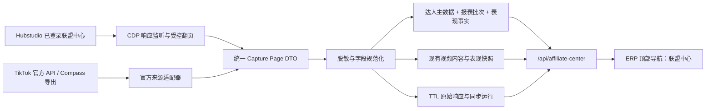

# TikTok Shop 联盟中心达人与视频采集、ERP 接入及官方 API 转换计划

> 执行顺序已调整为 Excel 优先。当前实施基线与后续转换步骤以
> `tiktok-shop-affiliate-center-excel-first-plan.md` 为准；本文保留为监听器逆向阶段的详细参考。

## 1. 计划结论

本项目建议采用“**统一领域模型 + 两套来源适配器**”的方式实施：

1. 第一阶段复用现有 Hubstudio/CDP 监听器，在卖家本人已登录、已授权的联盟中心页面内，采集“达人”和“所有视频”的真实响应；
2. 页面响应先经过端点白名单、脱敏、解析和幂等写入，再由 ERP 内部 API 对外提供稳定契约；
3. ERP 顶部导航新增一个“联盟中心”模块，模块内包含“达人”和“所有视频”两个页面；
4. 后续接入官方 API 时，只替换来源适配器，不改变数据库中的规范化语义、ERP 内部 API 或前端页面；
5. 视频官方化优先复用当前项目已有的 TikTok Shop Analytics `202605` 接入骨架；达人及大批量联盟数据优先评估 Affiliate Compass 离线导出 API；Marketplace Creator API 只负责资料补全，不直接等同于店铺联盟经营数据。

页面监听是过渡数据源，不作为长期唯一生产依赖。实现范围仅限当前卖家账号有权查看的数据，不处理验证码绕过、风控规避、跨店访问、Cookie/token 导出或页面私有接口在浏览器外的重放。

## 2. 当前代码基线与可复用能力

### 2.1 已有监听器

`erp-api/backend/app/services/tiktok_affiliate_capture.py` 已具备：

- 通过 Playwright `connect_over_cdp` 连接 Hubstudio 浏览器；
- 监听多个 BrowserContext 的 `response` 事件；
- 按请求方法和 URL path 做白名单过滤；
- 解析响应、写入原始表和业务表；
- 单进程写入锁、后台任务收敛、断线重连和安全日志。

本次不重写 CDP 基础设施，只新增联盟分析端点契约、解析器和同步器，并在现有 capture session 中注册。

### 2.2 已有视频正式模型与官方 API 骨架

当前后端已经存在：

- `tiktok_video_contents`：店铺内视频最新内容维度；
- `tiktok_video_performance_snapshots`：视频在精确时间窗口内的表现快照；
- `analytics_sync_runs` / `analytics_sync_cursors`：同步运行、恢复游标和提交游标；
- `analytics_raw_payloads`：带 TTL 的后端原始响应；
- `HttpTikTokAnalyticsClient`：分页、日期范围、币种和 `account_type` 处理；
- `.env.example` 已指向 `/analytics/202605/shop_videos/performance`，并已配置 creator attribution 字段映射。

因此“所有视频”不能新建一套重复表。页面监听数据和官方视频 API 都应写入现有视频内容及表现快照。

### 2.3 现有 `scraped_data` 的定位

`scraped_data` 适合短期反向分析和旧证据关联，但缺少本次查询所需的明确 `shop_id`、时间窗口、同步运行和分页完整性语义。它不应成为联盟中心正式列表的数据源。

建议：

- 端点发现阶段可以短期使用 `scraped_data` 或文件内存 fixture；
- 正式采集使用 `analytics_raw_payloads` 保留经过脱敏的响应页，默认 TTL 7 天；
- ERP 页面只读取规范化表，绝不返回原始页面响应。

## 3. 目标范围

### 3.1 第一阶段必须覆盖

- 一个已授权店铺下的联盟达人全量分页；
- 一个明确店铺时区、起止日期、币种和筛选条件下的所有视频全量分页；
- 达人和视频的稳定身份关联；
- 达人列表的经营指标、视频列表的内容和表现指标；
- 每次采集的总数、页数、唯一记录数、重复数、失败页和游标闭环；
- ERP 顶部导航“联盟中心”；
- 联盟中心的“达人”和“所有视频”页面；
- 数据来源、最近更新时间、是否完整、是否陈旧和失败原因可见。

### 3.2 明确不做

- 不访问卖家账号本身无权查看的达人或店铺数据；
- 不绕过 CAPTCHA、设备校验、限流或平台风控；
- 不保存请求头、Cookie、access token、签名参数、OAuth code/state；
- 不采集达人消息、邮箱、电话、地址等与本模块无关的数据；
- 不批量下载视频文件，首期只保存视频 ID、封面 URL、元数据和经营指标；
- 不把畅销榜 Top 100 当作“全部达人/全部视频”；
- 不用无界历史回填冒充“全量”。全量始终指明确查询窗口和筛选条件下的全部分页记录。

## 4. 目标架构



核心约束：`browser_capture`、`compass_export`、`shop_video_api` 只表示来源，不改变领域字段含义。

### 4.1 达人数据分层原则

根据联盟中心导出表，达人字段必须按“**稳定身份**”和“**时间窗口表现**”分层。逻辑上至少两层，物理上推荐三张表：

1. `affiliate_creators`：达人身份维度，只保存 Open ID、平台来源 ID、用户名、当前昵称/头像、首次和最近观察时间等相对稳定字段；
2. `affiliate_performance_reports`：一次页面查询或一次导出任务的报表批次，保存店铺、时间窗口、店铺时区、币种、计划类型、筛选条件、数据来源、完整性和版本；
3. `affiliate_creator_performance_rows`：报表内每个达人的表现事实，一名达人每个报表批次一行。

同一个达人切换时间范围后，不更新旧表现行，而是生成新的 report 和 performance row。即：

```text
达人 A（主数据 1 行）
  ├─ 2026-08-01 至 2026-08-07（表现 1 行）
  ├─ 2026-08-08 至 2026-08-14（表现 1 行）
  └─ 2026-08-01 至 2026-08-30（表现 1 行）
```

不同时间窗口不能相加后冒充任意区间结果，因为 7 天、30 天报表可能重叠。同一窗口重新导出时也不能直接覆盖：若归因、退款或结算延迟导致数值变化，应生成同一 query fingerprint 的新 revision，ERP 默认读取最新完整 revision，并保留旧 revision 用于对账。

## 5. 分步执行计划

## 第 0 步：冻结业务口径和安全边界（已完成）

### 要做什么

1. 以截图中的“达人”和“所有视频”为两个独立资源；
2. 冻结查询维度：`shopId + windowStart + windowEnd + shopTimezone + currency + filters`；
3. 明确页面展示指标的定义、币种、单位、时间窗口和排序语义；
4. 规定页面监听只允许在当前登录会话内发生，不把浏览器凭证搬到后端；
5. 确认原始响应 TTL、日志白名单和禁止字段；
6. 定义“全量完成”：到达 `has_more=false` 或空 `next_cursor`，且唯一记录数与 `total_count`（若有）一致。

达人页面当前展示指标已由 Excel 契约和数据库字段冻结；精确定义见 `tiktok-shop/affiliate-center-capture-contract.md`。视频截图没有提供可验证字段，因此视频指标状态固定为 `awaiting_verified_payload`，真实响应验证前不进入生产 UI。

### 涉及文件

- `erp-web/docs/tiktok-shop/affiliate-center-capture-contract.md`
- `erp-api/src/erp_api/services/affiliate_center_display_contract.py`
- `erp-api/src/erp_api/services/affiliate_center_capture_policy.py`
- 新增 `erp-api/tests/fixtures/tiktok_affiliate_center/README.md`
- 新增经过合成或彻底脱敏的 creator/video 响应 fixture

### 产出与验收

- 端点、方法、分页、请求窗口和响应字段表完成；
- 文档、fixture、日志中均不存在 token、Cookie、签名和个人隐私；
- 字段未验证前使用 `unknown`/`extensions`，不猜测成正式指标。

## 第 1 步：真实端点发现与响应契约冻结（已完成）

### 要做什么

1. 启动现有 CDP 监听环境；
2. 手动打开联盟中心“达人”，切换一次日期、筛选和排序，并翻到第二页；
3. 手动打开“所有视频”，执行同样操作；
4. 只记录命中的 host、method、path、content-type、状态码、分页字段名、响应字段路径和 request ID；
5. 不记录 query 中的动态签名参数，不记录 headers 和 request body 中的敏感字段；
6. 为两个响应编写严格 payload discriminator，避免同 path 的其他响应被误解析；
7. 记录分页属于 `page/page_size`、offset、cursor 或混合模式，不提前假设。

### 涉及文件

- 新增 `erp-api/src/erp_api/services/affiliate_center_contract_observer.py`
- 新增 `erp-api/src/erp_api/services/affiliate_center_payload_contract.py`
- 新增 `erp-api/tests/test_affiliate_center_contract_observer.py`
- 新增 `erp-api/tests/test_affiliate_center_payload_contract.py`
- 修改 `erp-web/docs/tiktok-shop/affiliate-center-capture-contract.md`
- 新增 `erp-web/docs/tiktok-shop/affiliate-center-observed-contracts-2026-08-25.json`

### 产出与验收

- 达人、视频端点均由真实操作命中；
- discriminator 能接受正确 fixture、拒绝相似错误 payload；
- 达人分页模式已由响应字段证据归类为 `page_page_size`；视频仅观察到 `total`，保持 `unknown`，不提前假设；
- 合同中没有任何短期签名值或真实账号凭证。

## 第 2 步：扩展 CDP 监听器并建立全量翻页控制（已完成）

### 要做什么

1. 新建独立同步器，监听第 1 步确认的达人和视频响应；
2. 在 `run_capture_session` 注册同步器，复用现有 BrowserContext、mutation lock、断线重连和安全日志；
3. 被动监听先捕获用户当前页；
4. 捕获首个有效请求模板后，在当前已登录 page 内进行受控翻页；
5. 优先让页面自身触发请求；若使用 `page.evaluate(fetch)`，只允许改分页和已批准的筛选字段，不实现签名算法、不导出浏览器凭证；
6. 增加最大页数、最大运行时长、最小请求间隔、重复 cursor 防护和连续空页终止；
7. 会话过期、CAPTCHA、403、429 或 payload 结构变化时立即停止本轮并显示失败，不静默重试成无限循环；
8. 每个资源独立维护完整性状态，达人完成不代表视频完成。

### 涉及文件

- 已新增 `erp-api/backend/app/services/tiktok_affiliate_analytics_capture.py`
- 已新增 `erp-api/backend/app/services/tiktok_affiliate_analytics_pager.py`
- 已新增 `erp-api/backend/app/services/tiktok_affiliate_analytics_run_state.py`
- 已新增 `erp-api/backend/app/services/tiktok_affiliate_analytics_page_evidence.py`
- 已新增 `erp-api/backend/app/services/tiktok_affiliate_analytics_page_control.py`
- 已新增 `erp-api/backend/app/services/tiktok_affiliate_listener_cli.py`
- 已修改 `erp-api/backend/app/services/tiktok_affiliate_capture.py`
- 已修改 `erp-api/src/erp_api/services/affiliate_center_capture_policy.py`
- 已新增 `erp-api/tests/test_tiktok_affiliate_analytics_capture.py`
- 已新增 `erp-api/tests/test_tiktok_affiliate_analytics_pager.py`
- 已新增 `erp-api/tests/test_tiktok_affiliate_analytics_run_state.py`
- 复用 `erp-api/backend/app/services/capture_logging.py`

### 运行状态结构

```text
resource_type: affiliate_creator | affiliate_video
status: queued | running | succeeded | partial | failed | session_required
expected_total: int | null
pages_fetched: int
records_received: int
records_unique: int
duplicates: int
last_cursor_hash: string | null
failure_category: string | null
started_at / finished_at
```

只保存 cursor 的不可逆摘要用于循环检测；不把原 cursor 打到日志。

### 产出与验收

- 对模拟 3 页数据恰好请求 3 页；
- 重复 cursor、空页、429、登录失效均能终止；
- 572 只是当前截图观察值，运行时必须以真实 `total_count` 为准，不能硬编码；
- 进程断开后，所有已启动 response task 能正确收敛。

## 第 3 步：建立统一解析器和来源无关 DTO

### 要做什么

1. 达人和视频分别建立 parser；
2. parser 输入是页面 payload 或官方 API/导出行，输出同一领域 DTO；
3. 金额转成 `amountMinor + currency`，禁止 float；
4. 比率保存为十进制字符串，例如 `0.0189`，展示层再格式化为 `1.89%`；
5. 时间统一存 UTC，同时保留本次查询的店铺时区；
6. `creatorOpenId` 作为首选稳定达人标识，页面私有 creator ID 放入 source identifiers，不互相覆盖；
7. 未确认字段进入 `extensions`，不得以相似名称强行映射；
8. 原始 payload 在入库前递归删除凭证、联系方式、消息等禁止字段。

### 涉及文件

- 新增 `erp-api/app/parsers/affiliate_creator_analytics_parser.py`
- 新增 `erp-api/app/parsers/affiliate_video_analytics_parser.py`
- 新增 `erp-api/src/erp_api/services/affiliate_center_dtos.py`
- 新增 `erp-api/src/erp_api/services/capture_payload_redaction.py`
- 新增对应 `test_*.py`

### 规范化达人结构

```json
{
  "creatorOpenId": "opaque-stable-id",
  "sourceCreatorId": "source-specific-id",
  "username": "creator_name",
  "nickname": "Creator Name",
  "avatarUrl": "https://allow-listed-cdn/...",
  "followerCount": 10120,
  "windowStart": "2026-08-17T08:00:00Z",
  "windowEnd": "2026-08-24T08:00:00Z",
  "shopTimezone": "America/Los_Angeles",
  "currency": "USD",
  "metrics": {
    "affiliateGmv": { "amountMinor": 67341, "currency": "USD" },
    "affiliateVideoGmv": { "amountMinor": 67341, "currency": "USD" },
    "affiliateShowcaseGmv": { "amountMinor": 0, "currency": "USD" },
    "affiliateProductItemsSold": 7,
    "estimatedCommission": { "amountMinor": 8863, "currency": "USD" },
    "estimatedFlatFee": { "amountMinor": 0, "currency": "USD" },
    "averageOrderAmount": { "amountMinor": 8843, "currency": "USD" },
    "itemsSold": 7,
    "skuOrders": 7,
    "showcaseProductCount": 0,
    "productImpressions": 13988,
    "averageCustomers": 1,
    "clickThroughRate": "0.0567",
    "affiliateLiveCount": 0
  },
  "extensions": {}
}
```

### 规范化视频结构

```json
{
  "platformVideoId": "video-id",
  "creatorOpenId": "opaque-stable-id",
  "creatorUsername": "creator_name",
  "creatorNickname": "Creator Name",
  "authorType": "AFFILIATE",
  "title": "Video title",
  "coverImageUrl": "https://allow-listed-cdn/...",
  "postedAt": "2026-08-18T02:10:00Z",
  "durationSeconds": 34,
  "hashTags": ["#toys"],
  "promotedProducts": [{ "id": "product-id", "name": "Product" }],
  "windowStart": "2026-08-17T08:00:00Z",
  "windowEnd": "2026-08-24T08:00:00Z",
  "currency": "USD",
  "metrics": {
    "views": 10900,
    "gmv": { "amountMinor": 67341, "currency": "USD" },
    "gpm": { "amountMinor": 6178, "currency": "USD" },
    "skuOrders": 7,
    "itemsSold": 7,
    "clickThroughRate": "0.0189"
  },
  "extensions": {}
}
```

### 产出与验收

- 相同实体从页面 fixture 和官方 fixture 解析后，规范化字段一致；
- 金额、比率、空值、超长文本、异常数组和字段缺失均有测试；
- DTO 和日志中没有敏感请求信息。

## 第 4 步：数据库模型、迁移与幂等写入

此步骤会新增数据库 schema，实施前需单独确认。

### 要做什么

1. 新增达人最新主数据表；
2. 新增联盟表现报表批次表；
3. 新增达人在报表批次内的表现事实表；
4. 视频继续复用 `tiktok_video_contents` 和 `tiktok_video_performance_snapshots`；
5. 同步运行复用 `analytics_sync_runs`，新增资源类型 `affiliate_creator` 和 `affiliate_video`；
6. 脱敏原始页写入 `analytics_raw_payloads`，默认 7 天 TTL；
7. 每页先写报表明细，再提交 recovery cursor；整轮完整后才把 report 标记为 `complete` 并推进 committed cursor；
8. 同一导出文件重复导入必须幂等；同一查询窗口的新版本必须作为新 revision 保留；
9. 所有查询和外键必须同时绑定 `tenant_id + shop_id`。

### 新表：`affiliate_creators`

| 字段                | 类型                   | 说明             |
| ------------------- | ---------------------- | ---------------- |
| `id`                | UUID                   | 内部主键         |
| `tenant_id`         | UUID                   | 租户边界         |
| `shop_id`           | UUID                   | 店铺边界         |
| `creator_open_id`   | varchar(128)           | 首选稳定标识     |
| `source_creator_id` | varchar(128), nullable | 页面来源标识     |
| `username`          | varchar(255), nullable | 用户名           |
| `nickname`          | varchar(255), nullable | 昵称             |
| `avatar_url`        | text, nullable         | 头像 URL         |
| `attributes`        | JSONB                  | 未固定的资料字段 |
| `first_seen_at`     | timestamptz            | 首次观察时间     |
| `last_seen_at`      | timestamptz            | 最近观察时间     |
| `source_updated_at` | timestamptz, nullable  | 平台更新时间     |

唯一键：`(tenant_id, shop_id, creator_open_id)`。

`follower_count` 会变化。如果导出中存在粉丝数，应保存在表现事实行中；主表可选保存 `latest_follower_count` 作为列表快速展示缓存，但不能作为历史值来源。

### 新表：`affiliate_performance_reports`

| 字段                           | 类型                   | 说明                                                           |
| ------------------------------ | ---------------------- | -------------------------------------------------------------- |
| `id`                           | UUID                   | 主键                                                           |
| `tenant_id`                    | UUID                   | 租户边界                                                       |
| `shop_id`                      | UUID                   | 店铺边界                                                       |
| `sync_run_id`                  | UUID                   | 关联同步运行                                                   |
| `window_start` / `window_end`  | timestamptz            | 半开时间窗口 `[start, end)`                                    |
| `shop_timezone`                | varchar(64)            | 查询时使用的店铺时区                                           |
| `currency`                     | varchar(3)             | ISO 4217                                                       |
| `window_type`                  | varchar(32), nullable  | `PAST_24H` / `PAST_7_DAYS` / `PAST_30_DAYS` 或自定义           |
| `plan_type`                    | varchar(16)            | `ALL` / `TARGET` / `OPEN` / `PARTNER`                          |
| `filter_json`                  | JSONB                  | 规范化筛选和排序条件                                           |
| `query_fingerprint`            | char(64)               | 店铺、窗口、币种和筛选条件摘要                                 |
| `revision_no`                  | integer                | 同一查询口径的版本号                                           |
| `source_kind`                  | varchar(32)            | `browser_capture` / `compass_export` / `official_api`          |
| `source_file_sha256`           | char(64), nullable     | 导出文件幂等键，只保存摘要                                     |
| `status`                       | varchar(16)            | `importing` / `complete` / `partial` / `failed` / `superseded` |
| `expected_row_count`           | integer, nullable      | 平台或导出声明的总数                                           |
| `imported_row_count`           | integer                | 实际唯一达人行数                                               |
| `platform_request_id`          | varchar(128), nullable | 排障 ID                                                        |
| `source_generated_at`          | timestamptz, nullable  | 导出生成时间                                                   |
| `captured_at` / `completed_at` | timestamptz            | 导入生命周期                                                   |

唯一键：`(tenant_id, shop_id, query_fingerprint, revision_no)`；同一店铺的相同 `source_file_sha256` 重复导入直接 no-op。ERP 只读取 `complete` 中最新 revision。

### 新表：`affiliate_creator_performance_rows`

| 字段                           | 类型                    | 说明                 |
| ------------------------------ | ----------------------- | -------------------- |
| `id`                           | UUID                    | 主键                 |
| `tenant_id` / `shop_id`        | UUID                    | 租户和店铺边界       |
| `report_id`                    | UUID                    | 关联表现报表批次     |
| `creator_id`                   | UUID                    | 关联达人主数据       |
| `follower_count`               | bigint, nullable        | 本报表时点观察值     |
| `affiliate_gmv_minor`          | bigint, nullable        | 联盟 GMV             |
| `affiliate_video_gmv_minor`    | bigint, nullable        | 联盟带货视频 GMV     |
| `affiliate_showcase_gmv_minor` | bigint, nullable        | 联盟商品橱窗 GMV     |
| `affiliate_product_items_sold` | bigint, nullable        | 联盟商品成交件数     |
| `items_sold`                   | bigint, nullable        | 成交件数             |
| `estimated_commission_minor`   | bigint, nullable        | 预计佣金             |
| `estimated_flat_fee_minor`     | bigint, nullable        | 预计固定费用         |
| `average_order_amount_minor`   | bigint, nullable        | 平均订单金额         |
| `showcase_product_count`       | bigint, nullable        | 联盟橱窗商品数       |
| `affiliate_order_count`        | bigint, nullable        | 联盟订单量           |
| `click_through_rate`           | numeric(12,8), nullable | 点击率原始小数       |
| `product_impressions`          | bigint, nullable        | 商品曝光次数         |
| `average_affiliate_customers`  | numeric(20,4), nullable | 平均联盟客户数       |
| `affiliate_live_count`         | bigint, nullable        | 联盟直播数           |
| `metrics_extra`                | JSONB                   | 未固定或后续新增指标 |
| `row_number`                   | integer, nullable       | 原导出行号，用于排障 |

唯一键：`(report_id, creator_id)`；常用排序指标使用显式数值列，不把全部指标塞进 JSONB。金额列共享 report 的 `currency`。

### 涉及文件

- 新增 `erp-api/src/erp_api/models/affiliate_creator.py`
- 新增 `erp-api/src/erp_api/models/affiliate_performance_report.py`
- 新增 `erp-api/src/erp_api/services/affiliate_creator_repository.py`
- 新增 `erp-api/src/erp_api/services/affiliate_center_ingest_service.py`
- 新增 `erp-api/migrations/versions/<revision>_create_affiliate_creator_analytics.py`
- 修改 `erp-api/src/erp_api/models/__init__.py`
- 修改 `erp-api/src/erp_api/services/analytics_repository.py`
- 修改 `erp-api/src/erp_api/services/video_performance_repository.py`
- 新增模型、repository、tenant filter 和迁移测试

### 产出与验收

- Alembic upgrade/downgrade 可执行；
- 重放相同页面或重复导入同一文件不增加重复达人、report revision 或表现行；
- 同一达人更换时间范围后，主表仍为一行，但新增独立 report 和表现行；
- 同一时间窗口后续重导产生新 revision，旧 revision 可追溯且默认不参与当前列表；
- A 租户/店铺不能读取 B 租户/店铺数据；
- 一页写入失败时不推进 committed cursor；
- 原始 payload 到期清空，规范化记录继续保留。

## 第 5 步：同步编排、完整性和可观测性

### 要做什么

1. 建立 `AffiliateCenterSource` 协议，使页面监听和官方来源输出同一分页 DTO；
2. 监听模式下，采集 daemon 在目标页面存在时自动发起一次有界同步；
3. API/ARQ 不直接持有浏览器状态，因此监听模式首期不提供“后端强制抓取”假象；
4. 官方模式下再由 ARQ 定时/手动触发同步；
5. 同步运行记录来源、窗口、筛选、预期总数、页数、接收数、唯一数和错误类别；
6. 当总数不一致、游标中断或部分页失败时状态为 `partial`，不得覆盖上一轮完整快照；
7. 日志仅记录 tenant/shop/run/request ID 和计数，不记录 payload 值。

### 涉及文件

- 新增 `erp-api/src/erp_api/services/affiliate_center_source.py`
- 新增 `erp-api/src/erp_api/services/affiliate_center_sync_service.py`
- 新增 `erp-api/src/erp_api/workers/affiliate_center_jobs.py`
- 修改 `erp-api/src/erp_api/workers/settings.py`
- 修改 `erp-api/src/erp_api/main.py`
- 修改 `erp-api/src/erp_api/core/config.py`
- 修改 `.env.*.example`，只增加非敏感配置
- 新增对应 service/job/failure 测试

### 建议配置

```text
AFFILIATE_CENTER_CREATOR_SOURCE=browser_capture
AFFILIATE_CENTER_VIDEO_SOURCE=browser_capture
AFFILIATE_CENTER_RAW_PAYLOAD_TTL_DAYS=7
AFFILIATE_CENTER_CAPTURE_MAX_PAGES=500
AFFILIATE_CENTER_CAPTURE_MIN_INTERVAL_MS=800
AFFILIATE_CENTER_CAPTURE_TIMEOUT_SECONDS=600
```

来源必须显式配置。真实来源失败时不得自动退回 Mock，也不得把旧数据标成新数据。

## 第 6 步：ERP 内部 API 与权限

此步骤会新增公共内部 API 和权限，实施前需单独确认。

### 要做什么

新增稳定接口：

```http
GET  /api/affiliate-center/creators
     ?shopId=&from=&to=&currency=&page=&pageSize=&sort=&order=

GET  /api/affiliate-center/videos
     ?shopId=&from=&to=&currency=&page=&pageSize=&sort=&order=&creatorOpenId=

GET  /api/affiliate-center/sync-status?shopId=

POST /api/affiliate-center/sync
```

约束：

- 列表使用本地数据库分页，不在 GET 请求中调用 TikTok；
- 所有查询按 `tenant_id + shop_id` 过滤；
- 统一返回 `apiVersion + source + data + freshness + errors`；
- `source` 明确为 `browser_capture`、`compass_export`、`shop_video_api` 或 `mixed_reconciled`；
- `mixed_reconciled` 只有显式对账逻辑通过后才能出现，不能隐式拼接；
- 页面监听模式下 `POST /sync` 返回明确的 `collector_required` 或当前 daemon 状态；
- 官方模式下 `POST /sync` 才进入 ARQ；
- 新增 `affiliate-center:view`，同步继续复用 `sync:trigger`。

### 涉及文件

- 新增 `erp-api/src/erp_api/routers/affiliate_center.py`
- 新增 `erp-api/src/erp_api/routers/affiliate_center_schemas.py`
- 新增 `erp-api/src/erp_api/services/affiliate_center_read_repository.py`
- 修改 `erp-api/src/erp_api/core/permissions.py`
- 修改 `erp-api/src/erp_api/main.py`
- 修改 `erp-web/docs/api-v1-contract.md`
- 新增 `erp-api/tests/test_affiliate_center_routes.py`
- 新增 `erp-api/tests/test_affiliate_center_read_repository.py`
- 新增 `erp-api/tests/test_affiliate_center_tenant_filters.py`

### 产出与验收

- 401/403/404、空数据、partial、stale、collector 未连接和官方限流分别可识别；
- API 不返回 raw payload、浏览器 URL、cursor、token 或平台错误原文；
- 达人和视频分页总数与最后一次完整采集运行一致。

## 第 7 步：前端顶部导航新增“联盟中心”

### 要做什么

1. 顶部主导航在“畅销榜”之后增加一个“联盟中心”入口；
2. 父路由 `/affiliate-center` 默认跳转 `/affiliate-center/creators`；
3. 模块内二级页签：`达人`、`所有视频`；
4. 两个页面共用店铺、日期范围、币种、来源状态和同步完整性展示；
5. 达人页展示头像、达人身份、GMV、预计佣金、成交件数、订单、客户数和点击率；
6. 视频页展示封面、标题、达人、发布时间、商品、观看量、GMV、订单和点击率；
7. 筛选条件写入 URL query，刷新和分享链接后可恢复；
8. 清楚显示 `数据来源`、`最近采集时间`、`完整/部分/陈旧`；
9. 真实数据失败时展示错误，不回退到 Mock。

### 涉及文件

新增：

- `erp-web/src/features/affiliate-center/api/affiliate-center.api.ts`
- `erp-web/src/features/affiliate-center/types/affiliate-center.types.ts`
- `erp-web/src/features/affiliate-center/queries/affiliate-center.queries.ts`
- `erp-web/src/features/affiliate-center/pages/affiliate-center-page.tsx`
- `erp-web/src/features/affiliate-center/pages/affiliate-center-page.css`
- `erp-web/src/features/affiliate-center/components/affiliate-center-nav.tsx`
- `erp-web/src/features/affiliate-center/components/affiliate-center-filters.tsx`
- `erp-web/src/features/affiliate-center/components/creator-table.tsx`
- `erp-web/src/features/affiliate-center/components/video-table.tsx`
- `erp-web/src/features/affiliate-center/components/source-status.tsx`
- 对应 `*.test.ts(x)`

修改：

- `erp-web/src/router/route-pages.tsx`
- `erp-web/src/router/route-metadata.tsx`
- `erp-web/src/auth/permission-codes.ts`
- `erp-web/src/layouts/basic-layout/page-tabs.ts`（若需要父子路由 tab 归并）
- 新增 `erp-web/src/router/affiliate-center-route.test.tsx`
- 修改 E2E session fixture，为测试用户增加 `affiliate-center:view`

### 产出与验收

- 有权限用户只看到一个顶层“联盟中心”入口；
- 无权限用户看不到入口，直接访问返回 403；
- `/affiliate-center/creators` 和 `/affiliate-center/videos` 切换不串数据；
- 572 条级别达人、数千条视频使用服务端分页，首屏不一次性加载全部；
- 移动宽度下筛选区收缩，表格允许横向滚动；
- 键盘操作、loading、empty、partial、stale 和 error 状态完整。

## 第 8 步：官方 API 适配与替换

### 8.1 官方来源优先级

#### A. Affiliate Compass 离线导出：批量联盟数据首选

官方 `202603` Compass Offline Export 提供创建任务、查询状态和下载 XLSX 的异步流程，适合大批量达人分析和视频表现。计划接入：

1. 创建离线任务；
2. ARQ 轮询任务状态；
3. 成功后下载临时 XLSX；
4. 校验 host、HTTPS、文件大小和内容类型；
5. 解析表头版本并映射到统一 DTO；
6. 导入完成后删除临时文件，不把下载 URL 长期保存。

`module_type=CREATOR` 可作为达人导出候选；视频对应的 `module_type/doc_type` 必须在 API Testing Tool 中以真实导出模板验证，未验证前不硬编码为 `BASE`。

#### B. Shop Video Performance `202605`：视频明细与窗口指标首选

项目当前已经配置：

```text
GET /analytics/202605/shop_videos/performance
account_type=AFFILIATE_ACCOUNTS
```

该版本可返回视频 ID、内容元数据、creator open ID、creator author type 及视频经营指标。转换工作主要是补齐字段测试、将 source 标为 `shop_video_api`，并与联盟中心的查询契约对接，不需要重建 transport、分页器或视频表。

#### C. Marketplace Creator API：达人资料补全

使用：

- Seller Search Creator on Marketplace；
- Get Marketplace Creator Performance。

它们适合补全头像、昵称、粉丝和近 30 天 Marketplace 表现，但不能直接替代截图中“该店铺、该窗口”的联盟 GMV/佣金口径。店铺窗口指标应优先来自 Compass 导出、官方视频表现聚合和联盟订单数据。

#### D. Open Collaboration Creator Content Detail：按商品补充

该接口需要 `product_id`，适合补充指定开放合作商品下的达人内容统计，不适合作为“全部达人/全部视频”的唯一主同步入口，否则会形成商品数乘分页数的调用量。

### 8.2 官方适配涉及文件

- 新增 `erp-api/src/erp_api/services/tiktok_affiliate_compass_client.py`
- 新增 `erp-api/src/erp_api/services/tiktok_affiliate_compass_schemas.py`
- 新增 `erp-api/src/erp_api/services/affiliate_compass_export_parser.py`
- 新增 `erp-api/src/erp_api/services/tiktok_marketplace_creator_client.py`
- 新增 `erp-api/src/erp_api/services/tiktok_marketplace_creator_schemas.py`
- 修改 `erp-api/src/erp_api/services/tiktok_data_client.py`
- 修改 `erp-api/src/erp_api/services/affiliate_center_sync_service.py`
- 修改 `erp-api/src/erp_api/workers/affiliate_center_jobs.py`
- 修改 `erp-api/src/erp_api/core/config.py`
- 修改 `.env.*.example`
- 新增对应 client/parser/worker 测试和合成 XLSX fixture

### 8.3 新依赖

监听阶段不需要新增运行时依赖，复用 Playwright、FastAPI、SQLAlchemy、PostgreSQL、Redis 和 ARQ。

官方 Compass XLSX 导入阶段预计新增：

```text
openpyxl>=3.1,<4
```

如果最终 Download API 能稳定提供 CSV，则不增加 `openpyxl`，复用标准库 `csv`。不引入 pandas，避免为流式表格导入增加不必要体积。

### 8.4 显式来源切换

```text
AFFILIATE_CENTER_CREATOR_SOURCE=browser_capture | compass_export
AFFILIATE_CENTER_VIDEO_SOURCE=browser_capture | shop_video_api | compass_export
```

不做自动 fallback。切换前执行影子对账：

1. 同一店铺、同一已结算时间窗口同时运行页面采集和官方来源；
2. 比较达人 ID 集合、视频 ID 集合、总记录数、GMV、订单和佣金口径；
3. 连续 3 个窗口通过后，才把正式读取来源切到官方；
4. 页面监听器再保留 14 天只读回滚能力，然后停止常驻，不立即删代码或历史快照。

建议验收阈值：

- 已结算窗口的达人/视频 ID 覆盖率不低于 99.5%；
- 相同定义的计数字段必须一致；
- 金额差异不高于 0.1%，或能由时区、退款、归因延迟给出逐项解释；
- 所有差异均输出安全的 reconciliation report，不直接混合两套来源掩盖差异。

## 第 9 步：端到端验证、灰度和回滚

### 后端验证

```powershell
cd D:\codex\projects\erp-api
.\.venv\Scripts\python.exe -m pytest -p no:cacheprovider
.\.venv\Scripts\alembic.exe upgrade head
.\.venv\Scripts\python.exe scripts\check_no_secrets.py
```

迁移实施时还要在临时数据库验证 downgrade；不得在共享真实数据库为了测试随意 downgrade。

### 前端验证

```powershell
cd D:\codex\projects\erp-web
npm run format:check
npm run lint:types
npm run test
npm run build
npm run test:e2e
```

### 真实数据抽样

- 达人第一页、中间页、最后一页各抽样；
- 视频第一页、最后一页及一个明确达人筛选各抽样；
- 核对店铺、日期、时区、币种、排序和总数；
- 核对同一视频的达人 open ID 和达人表关联；
- 核对页面导出/官方导出与数据库总数；
- 检查日志、API 响应、浏览器 console 和数据库原始表均无凭证。

### 灰度顺序

1. 单店、最近 7 天；
2. 单店、最近 30 天；
3. 对账通过后开启每日增量；
4. 多店铺扩展前单独验证 shop/tenant 过滤；
5. 历史窗口按明确区间逐批回填，不做无界抓取。

### 回滚

- 前端通过权限和 route rollout 隐藏模块；
- 后端停止 capture daemon 或官方 sync job；
- 保留最后一次完整快照并标记 stale；
- 不删除快照、不自动回退 Mock、不用 partial 覆盖 complete。

## 6. 文件变更总表

### `erp-api` 重点新增

- `backend/app/services/tiktok_affiliate_analytics_contract.py`
- `backend/app/services/tiktok_affiliate_analytics_capture.py`
- `backend/app/services/tiktok_affiliate_analytics_pager.py`
- `app/parsers/affiliate_creator_analytics_parser.py`
- `app/parsers/affiliate_video_analytics_parser.py`
- `src/erp_api/models/affiliate_creator.py`
- `src/erp_api/services/affiliate_center_dtos.py`
- `src/erp_api/services/affiliate_center_source.py`
- `src/erp_api/services/affiliate_center_ingest_service.py`
- `src/erp_api/services/affiliate_center_sync_service.py`
- `src/erp_api/services/affiliate_center_read_repository.py`
- `src/erp_api/routers/affiliate_center.py`
- `src/erp_api/routers/affiliate_center_schemas.py`
- `src/erp_api/workers/affiliate_center_jobs.py`
- 一个 Alembic migration 和对应测试

### `erp-api` 重点修改

- `backend/app/services/tiktok_affiliate_capture.py`
- `src/erp_api/models/__init__.py`
- `src/erp_api/services/analytics_repository.py`
- `src/erp_api/services/video_performance_repository.py`
- `src/erp_api/core/config.py`
- `src/erp_api/core/permissions.py`
- `src/erp_api/workers/settings.py`
- `src/erp_api/main.py`
- `.env.example`、`.env.development.example`、`.env.production.example`

### `erp-web` 重点新增

- `src/features/affiliate-center/` 整个功能目录
- `src/router/affiliate-center-route.test.tsx`

### `erp-web` 重点修改

- `src/router/route-pages.tsx`
- `src/router/route-metadata.tsx`
- `src/auth/permission-codes.ts`
- `src/layouts/basic-layout/page-tabs.ts`（仅父子 tab 需要归并时）
- `docs/api-v1-contract.md`

所有 Python/TypeScript 文件按项目规范拆分，每个文件不超过 300 行。

## 7. 工期估算

| 阶段                                    | 预计工作量 |
| --------------------------------------- | ---------: |
| 真实端点发现、字段合同、脱敏 fixture    |   1–2 人日 |
| 监听器、受控翻页、完整性状态            |   2–3 人日 |
| parser、DTO、模型、迁移、repository     |   2–3 人日 |
| 内部 API、权限、同步状态                |   1–2 人日 |
| 联盟中心前端与导航                      |   2–3 人日 |
| 自动化测试、真实数据对账、单店灰度      |   2–3 人日 |
| 页面采集版本合计                        | 10–16 人日 |
| 官方 Compass/Marketplace 适配与双源对账 |   3–6 人日 |

外部等待不计入：联盟 API scope 审批、应用状态审核、真实导出任务生成时间及平台字段变更。

## 8. 开工前决策点

1. 确认按“两层逻辑、三张物理表”新增达人主表、表现报表批次表、表现事实表及对应 Alembic migration；
2. 确认内部权限使用 `affiliate-center:view`；
3. 确认原始脱敏响应 TTL 默认 7 天；
4. 确认“联盟中心”在顶部导航中排在“畅销榜”之后；
5. 确认首轮只做一个店铺的最近 7 天，完成总数对账后再扩到 30 天；
6. 实施第 1 步时必须有当前已登录的 Hubstudio 联盟中心页面，用于真实确认端点和分页；
7. 官方切换前确认应用状态及 `seller.affiliate_collaboration.read`、`seller.creator_marketplace.read`、`data.shop_analytics.public.read` 三类 scope 的实际授权状态。

## 9. 官方资料

- [Affiliate Creator API overview](https://partner.tiktokshop.com/docv2/page/affiliate-creator-api-overview)
- [Create Compass Offline Export Task 202603](https://partner.tiktokshop.com/docv2/page/create-compass-offline-export-task-202603)
- [Get Shop Video Performance List 202605](https://partner.tiktokshop.com/docv2/page/get-shop-video-performance-list-202605)
- [Get Marketplace Creator Performance](https://partner.tiktokshop.com/docv2/page/get-marketplace-creator-performance)
- [Get Open Collaboration Creator Content Detail 202508](https://partner.tiktokshop.com/docv2/page/get-open-collaboration-creator-content-detail-202508)
- [TikTok Shop developer guide](https://partner.tiktokshop.com/docv2/page/tts-developer-guide)
