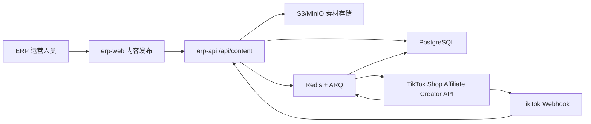

# TikTok Shop 内容发布模块实施计划

> 计划日期：2026-08-21  
> 适用项目：`D:\codex\projects\erp-api`、`D:\codex\projects\erp-web`  
> 当前状态：规划完成，尚未修改公共 API、数据库 Schema 或业务代码  
> 主链路：TikTok Shop Affiliate Creator API，不以普通 TikTok Content Posting API 代替带货内容接口

## 1. 结论与建议范围

本模块建议建设为一条独立的“创作者连接 → 橱窗/店铺商品 → 素材库 → 内容草稿 → 合规预检 → 发布任务 → 发布状态 → 表现快照”链路。

首期交付范围：

- 创作者授权、资料和授权范围展示；
- 获取创作者橱窗商品和可挂载商品；
- 视频、图片素材上传、校验和复用；
- 带货视频/图片草稿、商品锚点和发布；
- 视频内容预检、发布状态轮询、失败原因和人工重试；
- 已发布内容列表及视频内容表现；
- 图片表现采用能力门禁：只展示官方接口实际返回且完成字段验证的数据，不用视频字段推测图片指标；
- 完整租户隔离、权限控制、状态审计和安全日志。

首期不包含：

- AI 自动生成视频、图片、文案或配音；
- 自动剪辑、字幕识别、音乐版权判断；
- 多平台一键分发；
- 未经运营确认的自动定时发布；
- 用 Seller Center 抓取或页面自动化补齐官方 API 缺失字段；
- 将卖家令牌当作创作者令牌复用；
- 浏览器直连 TikTok Shop Open API 或持有平台密钥。

## 2. 官方 API 能力和硬性门禁

### 2.1 应采用的官方接口

| 能力             | 官方接口/版本基线                                               | 授权主体与 Scope                                  | 计划用途                                                      |
| ---------------- | --------------------------------------------------------------- | ------------------------------------------------- | ------------------------------------------------------------- |
| 创作者授权       | Creator authorization guide、Token get/refresh                  | 创作者令牌，`user_type=1`                         | 单独建立创作者连接，校验 `granted_scopes`                     |
| 创作者资料       | `GET /affiliate_creator/202508/profiles`                        | `creator.affiliate.info` 或 `creator.video.write` | 昵称、头像、区域、账号状态                                    |
| 橱窗商品         | `GET /affiliate_creator/202405/showcases/products`              | `creator.showcase.read` 或 `creator.video.write`  | 读取 `SHOWCASE` / `LIVE` 商品                                 |
| 添加橱窗商品     | `POST /affiliate_creator/202405/showcases/products/add`         | `creator.showcase.write` 或 `creator.video.write` | 二期可选；首期只读即可                                        |
| 视频素材上传     | `POST /affiliate_creator/202505/videos/video_files`             | `creator.video.write`                             | 100 MB 以内的直接上传                                         |
| 大文件上传       | `/open/202512/file/init` + 分块上传                             | `creator.video.write`                             | 10 MB 以上优先分块；业务上限以当前接口实测为准                |
| 视频预检         | `POST /affiliate_creator/202511/videos/precheck_task`           | `creator.video.write`                             | 检查视频和商品锚点违规风险                                    |
| 预检结果         | `GET /affiliate_creator/202511/videos/precheck_tasks/{task_id}` | `creator.video.write`                             | 发布前门禁                                                    |
| 发布带货视频     | `POST /affiliate_creator/202603/videos`；优先评估 202607        | `creator.video.write`                             | 传入视频文件、封面、标题、音乐和商品锚点                      |
| 发布带货图片     | Partner Center 的 Post Shoppable Photos；优先评估 202607        | `creator.video.write`                             | 图片内容发布；Phase 0 冻结实际字段                            |
| 发布状态         | `GET /affiliate_creator/202509/videos/{video_id}/status`        | `creator.video.write`                             | 轮询平台结果并映射内部状态                                    |
| 创作者视频表现   | `GET /analytics/202403/videos/performances`                     | `creator.video.write`                             | 锚点展示率、点击率、订单、销量、GMV；官方说明为美国创作者专用 |
| 店铺视频表现     | `GET /analytics/202605/shop_videos/performance`                 | 卖家令牌，`data.shop_analytics.public.read`       | 店铺视频、创作者归属、互动和电商表现，T+1                     |
| 商品锚点变更事件 | Shoppable content posting webhook，事件类型 `17`                | 相应创作者联属读取授权                            | ADD/UPDATE/REMOVE 商品链接事件，幂等消费                      |

官方资料：

- [Creator authorization guide](https://partner.tiktokshop.com/docv2/page/creator-authorization-guide)
- [Get Creator Profile](https://partner.tiktokshop.com/docv2/page/get-creator-profile)
- [Get Showcase Products](https://partner.tiktokshop.com/docv2/page/get-showcase-products)
- [Upload Shoppable Video File](https://partner.tiktokshop.com/docv2/page/upload-shoppable-video-file-202505)
- [Large File Uploads](https://partner.tiktokshop.com/docv2/page/wfi3nz36)
- [Precheck Video Content](https://partner.tiktokshop.com/docv2/page/precheck-video-content-202511)
- [Post Shoppable Video](https://partner.tiktokshop.com/docv2/page/post-shoppable-video-202603)
- [Get Shoppable Video Status](https://partner.tiktokshop.com/docv2/page/get-shoppable-video-status-202509)
- [Get Video Performances](https://partner.tiktokshop.com/docv2/page/get-video-performances-202403)
- [Analytics API Response Data Optimization](https://partner.tiktokshop.com/docv2/page/kpkfccsa)
- [Shoppable content posting webhook](https://partner.tiktokshop.com/docv2/page/17-shoppable-content-posting)
- [TikTok Shop changelog](https://partner.tiktokshop.com/docv2/changelog)

### 2.2 开发前必须通过的 Gate 0

> 2026-08-21 执行结果：应用级 `creator.video.write` 已 Active，Creator OAuth、共享回调分流和独立加密存储已完成；当前仍因缺少 Creator Token 且 202607 发布契约尚未冻结而处于 `BLOCKED_EXTERNAL_AUTH_AND_CONTRACT`。详见 [`tiktok-shop/content-api-gate0-report.md`](tiktok-shop/content-api-gate0-report.md)。

在写发布业务前，必须用当前应用和一个创作者测试账号完成以下探针：

1. Partner Center 中应用已启用或获批 `creator.video.write`；按需要补充 `creator.showcase.read`、`creator.affiliate.info`、`data.shop_analytics.public.read`。
2. 创作者完成独立授权；换取令牌后验证：
   - `code == 0`；
   - `user_type == 1`；
   - `open_id` 非空；
   - `granted_scopes` 覆盖目标功能。
3. 使用测试令牌调用 Creator Profile、Showcase Products、Upload、Precheck、Post、Status，各保存一份脱敏 Fixture。
4. 在 Partner Center API Testing Tool 中冻结 Post Shoppable Video/Photos 的当前可用版本。2026-07 变更日志已出现 v202607，不能只根据旧版字段开发。
5. 验证目标市场：
   - 创作者选择区域与应用目标市场一致；
   - `Get Video Performances` 是否对当前创作者市场开放；
   - 店铺视频表现是否能覆盖本 ERP 的店铺和账号类型；
   - 图片内容能返回哪些状态、内容 ID 和表现字段。
6. 验证文件限制、发布频率、风控错误、商品不可用、创作者禁发等真实错误映射。

Gate 0 未通过时允许交付“授权、素材库、草稿、只读表现”，但不得把发布按钮伪装为可用，也不得静默降级为 Mock。

## 3. 与现有 ERP 的衔接方式

现有能力可复用：

- `erp-api/src/erp_api/services/tiktok_transport.py`：复用签名、超时、重试、`Retry-After`、平台 request ID 和脱敏日志；需扩展流式/分块上传能力，不新建另一套签名实现。
- `erp-api/src/erp_api/services/token_cipher.py`：复用令牌加密，但创作者连接必须单独建模。
- `erp-api/src/erp_api/workers/`、Redis、ARQ：复用异步队列，执行预检、上传、发布、状态轮询和表现同步。
- `erp-api/src/erp_api/models/video_performance_snapshot.py` 及 analytics 读取链路：复用已验证的视频分析字段和展示逻辑；内容发布的状态与尝试记录仍需独立表。
- `erp-api/src/erp_api/models/tiktok_webhook_event.py`：复用 webhook 入站幂等和审计模式。
- `erp-web/src/services/http-client.ts`：已有上传进度能力。
- `erp-web/src/features/data/`：复用指标卡、趋势图、视频榜单、内容图片单元格和数据新鲜度展示。
- `erp-web/src/features/_template/README.md`：继续按 `types/api/queries/components/pages` 划分内容模块。

目标调用链：



安全边界：

- 浏览器只访问 ERP `/api`，不接触 `app_secret`、创作者 access/refresh token、签名、TikTok 上传令牌或原始错误体。
- 卖家连接和创作者连接使用不同记录、不同授权状态和不同功能检查。
- 所有业务表继承 `TenantScoped`，查询必须同时约束 `tenant_id` 和资源所有权。
- 平台原始响应仅后端保存，设置保留期；API 只返回白名单 DTO。
- “发布”权限与“编辑草稿”权限分离；发布动作记录操作者、请求 ID、草稿版本和平台 request ID。

## 4. 分阶段执行步骤

### Step 0：权限、版本和真实接口探针

需要做什么：

- 完成 2.2 的 Gate 0；
- 建立官方 API 版本矩阵、Scope 矩阵、市场矩阵和错误码矩阵；
- 记录脱敏的请求/响应 Fixture；
- 决定首期是否同时启用图片发布和图片表现。

涉及文件：

- 新增 `erp-web/docs/tiktok-shop/content-api-capability-matrix.md`
- 新增 `erp-web/docs/tiktok-shop/content-api-field-mapping.md`
- 新增 `erp-api/scripts/probe_tiktok_creator_content.py`
- 新增 `erp-api/tests/fixtures/tiktok_content/`
- 修改 `erp-api/.env.example`、`.env.development.example`，只增加变量名和示例，不写真实密钥

验收标准：

- 每个目标接口至少有一次真实成功或明确的官方拒绝证据；
- 能区分应用缺 Scope、创作者未授权、令牌类型错误、市场不支持和业务风控；
- 确认当前版本后再进入 Schema 和客户端实现。

### Step 1：冻结内部 API 契约、状态机和权限

需要做什么：

- 定义内部 `/api/content` 契约，沿用 `X-API-Contract-Version: v1` 和统一响应结构；
- 确定草稿、校验、预检、上传、发布、平台处理、成功、失败和取消状态；
- 定义权限：
  - `content:view`
  - `content:edit`
  - `content:publish`
  - `content:analytics:view`
  - `content:connections:manage`
- 定义错误码和可重试策略。

涉及文件：

- 新增 `erp-web/docs/tiktok-shop/content-api-contract.md`
- 新增 `erp-web/docs/tiktok-shop/content-status-mapping.md`
- 修改 `erp-api/src/erp_api/core/permissions.py`
- 修改 `erp-web/src/auth/permission-codes.ts`
- 修改 `erp-web/src/services/auth/mock-auth-api.ts`，仅用于权限展示测试

建议状态机：

```text
DRAFT
  -> VALIDATING -> VALIDATION_FAILED
  -> READY
  -> UPLOADING -> UPLOAD_FAILED
  -> PRECHECKING -> PRECHECK_FAILED
  -> READY_TO_PUBLISH
  -> PUBLISHING
  -> PROCESSING
  -> PUBLISHED | FAILED | CANCELLED
```

约束：

- `FAILED` 不原地重写为 `PUBLISHING`；重试新建 `publication_attempt`。
- 状态只能由后端状态机推进，前端不得上传任意状态值。
- 图片若无官方预检接口，则记录 `precheck_status=NOT_SUPPORTED`，不是 `PASSED`。

### Step 2：数据库和领域模型

> 审批点：本步骤会新增数据库 Schema，实际实施前需由用户确认迁移方案和回滚方案。

需要做什么：

- 新建创作者连接、橱窗快照、素材、草稿、草稿素材、发布尝试、状态事件和表现快照表；
- 建立租户、创作者、素材、草稿和发布记录之间的复合外键；
- 外部 ID 一律用字符串；金额使用最小货币单位加 ISO 4217 currency；比例使用定点小数；时间使用 UTC；
- 对平台状态、Scope 和未知字段采用白名单映射，原始 payload 单独存储并设置 TTL。

涉及文件：

- 新增 `erp-api/src/erp_api/models/creator_connection.py`
- 新增 `erp-api/src/erp_api/models/creator_showcase_product.py`
- 新增 `erp-api/src/erp_api/models/content_asset.py`
- 新增 `erp-api/src/erp_api/models/content_draft.py`
- 新增 `erp-api/src/erp_api/models/content_draft_asset.py`
- 新增 `erp-api/src/erp_api/models/content_publication.py`
- 新增 `erp-api/src/erp_api/models/content_publication_event.py`
- 新增 `erp-api/src/erp_api/models/content_performance_snapshot.py`
- 修改 `erp-api/src/erp_api/models/__init__.py`
- 新增一组 `erp-api/migrations/versions/*_create_content_domain_tables.py`
- 新增 `erp-api/tests/test_content_models.py`
- 新增 `erp-api/tests/test_content_tenant_scope.py`

核心表建议见第 6 节。

### Step 3：创作者授权和连接管理

需要做什么：

- 生成单次 `state` 的创作者授权链接；
- 回调严格验证 `state`、有效期和一次性使用；
- 后端换取/刷新创作者 token，验证 `user_type=1` 和 `granted_scopes`；
- 加密保存 access/refresh token；
- 同步 Creator Profile；
- 提供断开、重新授权、Scope 缺失和到期预警。

涉及文件：

- 新增 `erp-api/src/erp_api/services/tiktok_creator_authorization.py`
- 新增 `erp-api/src/erp_api/services/creator_connection_repository.py`
- 新增 `erp-api/src/erp_api/services/tiktok_creator_client.py`
- 新增 `erp-api/src/erp_api/routers/content_connections.py`
- 新增 `erp-api/src/erp_api/routers/content_connection_schemas.py`
- 修改 `erp-api/src/erp_api/core/config.py`
- 修改 `erp-api/src/erp_api/main.py`
- 新增 `erp-api/tests/test_creator_authorization.py`
- 新增 `erp-api/tests/test_creator_connections.py`

验收标准：

- 同一租户可连接多个创作者；同一 `creator_open_id` 不重复；
- 令牌和授权 code 不出现在日志、API 响应和前端存储；
- 卖家 token 调创作者 API 时返回明确的内部错误，而不是泛化为 500；
- Scope 缺失时页面显示可操作的重新授权入口。

### Step 4：创作者资料、橱窗和可挂载商品

需要做什么：

- 读取并缓存 Creator Profile；
- 分页同步 `SHOWCASE` 和可选 `LIVE` 商品，最多按官方上限处理；
- 读取 Get Shop Products 或现有 ERP 商品，形成“可挂载商品”选择器；
- 展示商品可用性、合作状态、橱窗来源和最近同步时间；
- 首期只读，添加/移除/置顶橱窗商品作为二期能力开关。

涉及文件：

- 新增 `erp-api/src/erp_api/services/creator_showcase_repository.py`
- 新增 `erp-api/src/erp_api/services/creator_catalog_service.py`
- 修改 `erp-api/src/erp_api/services/tiktok_creator_client.py`
- 新增 `erp-api/src/erp_api/routers/content_creators.py`
- 新增 `erp-api/tests/test_creator_showcase_sync.py`
- 新增 `erp-web/src/features/content/components/creator-selector.tsx`
- 新增 `erp-web/src/features/content/components/showcase-product-picker.tsx`

验收标准：

- 橱窗商品按创作者和租户隔离；
- 翻页可恢复、重复同步幂等；
- 商品失效后不能继续发布，并给出明确原因。

### Step 5：素材库和上传链路

需要做什么：

- ERP 素材先进入 S3/MinIO，不把大文件长期放在 API 本地磁盘；
- 浏览器使用 ERP 签发的预签名地址上传到对象存储；
- 后端完成大小、MIME、文件签名、SHA-256、尺寸、时长、宽高比和重复文件校验；
- 使用 `ffprobe` 读取视频元数据，使用 Pillow 读取图片元数据；
- 小视频可流式转传到 Upload Shoppable Video File；大视频使用官方分块上传；
- 保存上传进度、TikTok file/resource ID、MD5、过期时间和失败原因；
- 为照片组保存排序和封面索引。

涉及文件：

- 新增 `erp-api/src/erp_api/services/object_storage.py`
- 新增 `erp-api/src/erp_api/services/media_probe.py`
- 新增 `erp-api/src/erp_api/services/content_asset_repository.py`
- 新增 `erp-api/src/erp_api/services/content_upload_service.py`
- 新增 `erp-api/src/erp_api/routers/content_assets.py`
- 新增 `erp-api/src/erp_api/routers/content_asset_schemas.py`
- 修改 `erp-api/src/erp_api/core/config.py`
- 修改 `erp-api/docker-compose.yml`，开发环境增加 MinIO
- 修改 `erp-api/pyproject.toml`
- 新增 `erp-api/tests/test_content_asset_validation.py`
- 新增 `erp-api/tests/test_content_upload_service.py`
- 新增 `erp-web/src/features/content/components/asset-uploader.tsx`
- 新增 `erp-web/src/features/content/components/asset-library.tsx`

验收标准：

- 上传可见进度，可取消 ERP 上传；失败后能安全重试；
- 相同租户同 SHA-256 可提示复用，不跨租户去重暴露；
- 进程重启不丢素材和上传状态；
- 不把整段大视频读入 API/Worker 内存。

### Step 6：草稿编辑、预检和发布

需要做什么：

- 创建视频或图片草稿，选择创作者、素材、商品锚点、标题、封面和可选音乐；
- 保存草稿版本号，防止多人覆盖；
- 后端再次验证创作者、Scope、商品、素材和发布频率；
- 视频先提交官方预检并轮询结果；
- 预检通过后才能发布；
- 发布请求使用 idempotency key，避免用户双击或队列重试造成重复发布；
- 平台返回内容 ID 后创建发布尝试并进入状态轮询。

涉及文件：

- 新增 `erp-api/src/erp_api/services/content_draft_repository.py`
- 新增 `erp-api/src/erp_api/services/content_publication_repository.py`
- 新增 `erp-api/src/erp_api/services/content_publication_service.py`
- 修改 `erp-api/src/erp_api/services/tiktok_creator_client.py`
- 新增 `erp-api/src/erp_api/routers/content_drafts.py`
- 新增 `erp-api/src/erp_api/routers/content_publications.py`
- 新增 `erp-api/src/erp_api/routers/content_publication_schemas.py`
- 新增 `erp-api/src/erp_api/workers/content_jobs.py`
- 修改 `erp-api/src/erp_api/workers/settings.py`
- 新增 `erp-api/tests/test_content_draft_routes.py`
- 新增 `erp-api/tests/test_content_publication_state_machine.py`
- 新增 `erp-api/tests/test_content_publication_service.py`

验收标准：

- 未通过校验/预检、商品失效或 Scope 缺失时无法发布；
- 同一 idempotency key 只产生一个平台发布尝试；
- 前端刷新或 Worker 重启后任务可恢复；
- 平台 request ID、耗时、结果和脱敏错误可追踪。

### Step 7：发布状态、Webhook 和失败处理

需要做什么：

- ARQ 对 `PROCESSING` 任务做退避轮询；
- 将官方 `post_status` 和错误码映射到内部状态；
- 消费事件类型 17 的商品链接变更 webhook；
- Webhook 先快速 200，后续异步、幂等处理；
- 记录状态时间线、失败归属和建议动作；
- 提供“刷新状态”和“复制为新草稿重试”，不盲目重放原发布请求。

涉及文件：

- 修改 `erp-api/src/erp_api/services/webhook_service.py`
- 修改或扩展 `erp-api/src/erp_api/models/tiktok_webhook_event.py`
- 修改 `erp-api/src/erp_api/workers/content_jobs.py`
- 新增 `erp-api/src/erp_api/services/content_status_service.py`
- 新增 `erp-api/tests/test_content_status_polling.py`
- 新增 `erp-api/tests/test_shoppable_content_webhook.py`

验收标准：

- 重复 webhook 不重复变更业务状态；
- 轮询有最大次数、退避和死信，不形成无限任务；
- 平台 `FAIL`、禁发、商品不可用、风控和限频分别显示正确动作。

### Step 8：视频/图片内容表现同步

需要做什么：

- 发布成功后异步关联平台内容 ID；
- 视频首选复用现有店铺视频分析链路，补充创作者自有视频表现接口；
- 指标按来源、统计窗口和抓取时间保存，不能覆盖为一个“最新总数”；
- 店铺视频分析使用 202605 版本，按创作者账号类型、店铺时区、T+1 和分页规则同步；
- 创作者视频表现一次最多 100 个同作者 video ID，窗口不超过最近 180 天并考虑一天延迟；
- 图片表现只有在 Phase 0 证明官方接口返回可识别的图片内容和指标后启用；否则页面显示“官方 API 暂未提供/当前应用未获权限”，不显示 0。

涉及文件：

- 新增 `erp-api/src/erp_api/services/content_performance_repository.py`
- 新增 `erp-api/src/erp_api/services/content_performance_sync_service.py`
- 修改 `erp-api/src/erp_api/services/tiktok_data_client.py` 或新增小型 creator performance client，避免混淆卖家/创作者令牌
- 修改 `erp-api/src/erp_api/workers/analytics_jobs.py`
- 新增 `erp-api/src/erp_api/routers/content_analytics.py`
- 评估复用 `erp-api/src/erp_api/services/video_performance_repository.py`
- 新增 `erp-api/tests/test_content_performance_sync.py`
- 修改/复用 `erp-web/src/features/data/components/`

首期建议指标：

| 类型     | 指标                                                     |
| -------- | -------------------------------------------------------- |
| 基础互动 | 播放量、点赞、评论、分享、发布时间（仅官方接口实际返回） |
| 电商漏斗 | 锚点展示率、点击率                                       |
| 转化     | 订单数、售出件数、GMV、GPM                               |
| 运营     | 发布成功率、审核耗时、失败率、素材复用率                 |

### Step 9：前端模块和路由

需要做什么：

- 新建独立 `content` feature，不把发布表单塞入现有 `data` 页面；
- 新增 Python/TypeScript/JavaScript 文件控制在 300 行以内，页面编排、表单、预览和数据访问按职责拆分；
- 增加内容总览、素材库、创建内容、发布队列、创作者账号和内容表现页面；
- 使用 React Query 管理查询/Mutation，上传使用已有 `uploadFile` 或对象存储预签名流程；
- 所有状态支持 loading、empty、error、permission denied 和 capability unavailable；
- 发布按钮同时受 ERP 权限、创作者 Scope、素材状态、预检状态和商品状态控制。

涉及文件：

- 新增 `erp-web/src/features/content/types/content.types.ts`
- 新增 `erp-web/src/features/content/api/content.api.ts`
- 新增 `erp-web/src/features/content/queries/content.queries.ts`
- 新增 `erp-web/src/features/content/pages/content-overview-page.tsx`
- 新增 `erp-web/src/features/content/pages/content-editor-page.tsx`
- 新增 `erp-web/src/features/content/pages/content-assets-page.tsx`
- 新增 `erp-web/src/features/content/pages/content-publications-page.tsx`
- 新增 `erp-web/src/features/content/pages/content-creators-page.tsx`
- 新增 `erp-web/src/features/content/pages/content-analytics-page.tsx`
- 新增 `erp-web/src/features/content/components/` 下的编辑器、预览、状态时间线、指标卡和筛选组件
- 修改 `erp-web/src/router/route-pages.tsx`
- 修改 `erp-web/src/router/route-metadata.tsx`
- 修改 `erp-web/src/auth/permission-codes.ts`
- 新增对应 Vitest 和 Playwright 测试

### Step 10：测试、灰度和上线

需要做什么：

- 单元测试：状态机、字段映射、错误映射、租户隔离、幂等、媒体校验；
- 合同测试：内部 API v1 响应和分页；
- MockTransport 测试：每个官方接口的成功、限流、token 过期、Scope 缺失、5xx；
- 集成测试：PostgreSQL、Redis、ARQ、MinIO、真实 ffprobe；
- 沙箱/测试创作者端到端：授权 → 上传 → 预检 → 发布 → 状态 → 表现；
- 前端 E2E：权限、上传进度、断点失败、双击发布、状态恢复；
- 先白名单一个租户和一个创作者，真实模式失败保持可见；
- 监控稳定后再放开多创作者和图片发布。

验证命令基线：

```powershell
& D:\codex\projects\erp-api\.venv\Scripts\python.exe -m pytest -q -p no:cacheprovider
npm --prefix D:\codex\projects\erp-web run quality
npm --prefix D:\codex\projects\erp-web run test:e2e
```

上线 Gate：

- 无跨租户数据访问；
- 无令牌、签名、授权 code、state 或平台上传 token 泄露；
- 同一发布请求无法产生重复帖子；
- Worker 重启可恢复；
- 失败状态、平台限流和 Scope 缺失可见；
- 图片表现未验证时明确显示不可用，不显示伪造的 0；
- 真实发布由白名单和 `content:publish` 双重控制。

## 5. 内部 API 草案

所有接口使用 ERP Bearer session、租户上下文、`X-API-Contract-Version: v1` 和统一 envelope。

### 5.1 创作者连接

| 方法   | 路径                                                           | 用途                                        |
| ------ | -------------------------------------------------------------- | ------------------------------------------- |
| POST   | `/api/content/creator-connections/authorization-url`           | 创建单次授权链接                            |
| GET    | `/api/content/tiktok/creator/callback`                         | TikTok Shop 创作者授权回调                  |
| GET    | `/api/content/creator-connections`                             | 连接列表和 Scope 状态                       |
| GET    | `/api/content/creator-connections/{id}`                        | 创作者资料详情                              |
| POST   | `/api/content/creator-connections/{id}/refresh`                | 刷新资料和 Scope                            |
| DELETE | `/api/content/creator-connections/{id}`                        | 断开 ERP 连接；平台撤权行为需按官方能力处理 |
| GET    | `/api/content/creator-connections/{id}/showcase-products`      | 橱窗商品列表                                |
| POST   | `/api/content/creator-connections/{id}/showcase-products/sync` | 异步同步橱窗                                |

### 5.2 素材和草稿

| 方法   | 路径                                | 用途                           |
| ------ | ----------------------------------- | ------------------------------ |
| POST   | `/api/content/assets/upload-init`   | 创建素材和对象存储上传会话     |
| POST   | `/api/content/assets/{id}/complete` | 完成上传并进入校验             |
| GET    | `/api/content/assets`               | 素材库分页                     |
| DELETE | `/api/content/assets/{id}`          | 仅删除未被草稿/发布引用的素材  |
| POST   | `/api/content/drafts`               | 创建草稿                       |
| GET    | `/api/content/drafts`               | 草稿列表                       |
| GET    | `/api/content/drafts/{id}`          | 草稿详情                       |
| PATCH  | `/api/content/drafts/{id}`          | 带版本号保存                   |
| POST   | `/api/content/drafts/{id}/validate` | 后端业务校验                   |
| POST   | `/api/content/drafts/{id}/precheck` | 视频预检                       |
| POST   | `/api/content/drafts/{id}/publish`  | 入队发布，要求 Idempotency-Key |

### 5.3 发布和表现

| 方法 | 路径                                            | 用途                   |
| ---- | ----------------------------------------------- | ---------------------- |
| GET  | `/api/content/publications`                     | 发布队列/历史          |
| GET  | `/api/content/publications/{id}`                | 详情和状态时间线       |
| POST | `/api/content/publications/{id}/refresh-status` | 手动刷新，受服务端限流 |
| POST | `/api/content/publications/{id}/copy-to-draft`  | 复制失败任务为新草稿   |
| GET  | `/api/content/analytics/overview`               | 指标卡和趋势           |
| GET  | `/api/content/analytics/posts`                  | 内容表现分页           |
| POST | `/api/content/analytics/resync`                 | 有权限的补同步任务     |

## 6. 预计数据结构

### 6.1 `creator_connections`

| 字段                          | 类型/约束   | 说明                                               |
| ----------------------------- | ----------- | -------------------------------------------------- |
| `id`                          | UUID PK     | 内部 ID                                            |
| `tenant_id`                   | UUID FK     | 租户隔离                                           |
| `platform`                    | varchar     | 固定 `TIKTOK_SHOP`                                 |
| `creator_open_id`             | varchar     | 外部 ID，租户内唯一                                |
| `display_name` / `avatar_url` | varchar     | 白名单资料字段                                     |
| `region`                      | varchar     | 创作者选择区域                                     |
| `access_token_encrypted`      | bytea/text  | 后端加密                                           |
| `refresh_token_encrypted`     | bytea/text  | 后端加密                                           |
| `access_token_expires_at`     | timestamptz | UTC                                                |
| `refresh_token_expires_at`    | timestamptz | UTC                                                |
| `granted_scopes`              | JSONB       | 最新实际授权 Scope                                 |
| `status`                      | varchar     | ACTIVE / SCOPE_MISSING / EXPIRED / REVOKED / ERROR |
| `last_profile_sync_at`        | timestamptz | 新鲜度                                             |
| `created_at` / `updated_at`   | timestamptz | 审计                                               |

### 6.2 `creator_showcase_products`

| 字段                                  | 类型/约束   | 说明                           |
| ------------------------------------- | ----------- | ------------------------------ |
| `id`                                  | UUID PK     | 内部 ID                        |
| `tenant_id` / `creator_connection_id` | 复合 FK     | 所有权                         |
| `platform_product_id`                 | varchar     | TikTok Shop 商品 ID            |
| `origin`                              | varchar     | SHOWCASE / LIVE                |
| `title` / `image_url`                 | varchar     | 展示字段                       |
| `availability_status`                 | varchar     | ACTIVE / UNAVAILABLE / UNKNOWN |
| `product_payload`                     | JSONB       | 后端保留，设置 TTL/裁剪        |
| `source_updated_at` / `observed_at`   | timestamptz | 平台时间和抓取时间             |

### 6.3 `content_assets`

| 字段                             | 类型/约束        | 说明                      |
| -------------------------------- | ---------------- | ------------------------- |
| `id`                             | UUID PK          | 素材 ID                   |
| `tenant_id`                      | UUID FK          | 租户隔离                  |
| `media_type`                     | varchar          | VIDEO / IMAGE             |
| `storage_key`                    | varchar unique   | 不暴露真实桶凭证          |
| `original_filename`              | varchar          | 安全清洗后的文件名        |
| `mime_type`                      | varchar          | 实测类型                  |
| `size_bytes`                     | bigint           | 文件大小                  |
| `sha256`                         | char(64)         | 租户内去重                |
| `width` / `height`               | int              | 媒体信息                  |
| `duration_ms`                    | bigint nullable  | 视频时长                  |
| `validation_status`              | varchar          | PENDING / PASSED / FAILED |
| `validation_errors`              | JSONB            | 稳定错误码，不含堆栈      |
| `tiktok_file_id` / `resource_id` | varchar nullable | 平台上传结果              |
| `created_by`                     | UUID             | ERP 用户                  |
| `created_at` / `updated_at`      | timestamptz      | 审计                      |

### 6.4 `content_drafts` 与 `content_draft_assets`

`content_drafts`：

- `id`, `tenant_id`, `creator_connection_id`；
- `media_type`: VIDEO / PHOTO；
- `title`, `description`, `music_id`；
- `platform_product_id`, `product_anchor_title`；
- `cover_timestamp_ms` 或 `photo_cover_index`；
- `status`, `version`, `created_by`, `updated_by`, timestamps。

`content_draft_assets`：

- `tenant_id`, `draft_id`, `asset_id`, `position`；
- 视频草稿只能有一个视频主素材；
- 图片草稿允许多张，顺序唯一；
- 通过数据库约束和服务层同时校验。

### 6.5 `content_publications` 与事件

`content_publications` 每行表示一次发布尝试：

- `id`, `tenant_id`, `draft_id`, `attempt_no`；
- `idempotency_key`，租户内唯一；
- `platform_api_version`；
- `precheck_task_id`, `precheck_status`；
- `platform_content_id`, `platform_publish_id`；
- `status`, `failure_category`, `failure_code`, `failure_summary`；
- `platform_request_id`；
- `submitted_by`, `submitted_at`, `published_at`, `last_polled_at`；
- `next_poll_at`, `poll_attempt_count`；
- `request_snapshot`，只保存脱敏白名单字段。

`content_publication_events` 只追加不覆盖：

- `publication_id`, `from_status`, `to_status`, `source`；
- `platform_request_id`, `reason_code`, `occurred_at`；
- `actor_user_id` 或 `worker_job_id`。

### 6.6 `content_performance_snapshots`

| 字段                                                          | 类型/约束             | 说明                    |
| ------------------------------------------------------------- | --------------------- | ----------------------- |
| `tenant_id` / `publication_id`                                | 复合 FK               | 对应 ERP 发布记录       |
| `platform_content_id`                                         | varchar               | 平台内容 ID             |
| `media_type`                                                  | varchar               | VIDEO / PHOTO / UNKNOWN |
| `source_endpoint` / `api_version`                             | varchar               | 指标来源可追溯          |
| `window_start` / `window_end`                                 | timestamptz/date      | 统计窗口                |
| `currency`                                                    | char(3)               | ISO 4217                |
| `view_count` / `like_count` / `comment_count` / `share_count` | bigint nullable       | 未返回时必须为 null     |
| `anchor_display_rate` / `click_through_rate`                  | numeric(9,6) nullable | 比例                    |
| `order_count` / `item_sold_count`                             | bigint nullable       | 转化                    |
| `gmv_amount_minor`                                            | bigint nullable       | 最小货币单位            |
| `observed_at` / `source_updated_at`                           | timestamptz           | 数据新鲜度              |

关键唯一约束：`tenant_id + platform_content_id + source_endpoint + window_start + window_end + observed_date/run_id`。

## 7. 预计依赖和基础设施

### 7.1 后端 Python

| 依赖                    | 用途                           | 建议                                   |
| ----------------------- | ------------------------------ | -------------------------------------- |
| `python-multipart`      | FastAPI 接收小文件/回调表单    | 必需                                   |
| `boto3` 或兼容的 S3 SDK | 预签名、Head、删除和对象管理   | 必需，上传大文件优先浏览器直达对象存储 |
| `Pillow`                | 图片格式、尺寸和基本完整性校验 | 必需                                   |
| `filetype`              | 纯 Python 文件签名识别         | 建议，避免只信浏览器 MIME              |
| 现有 `httpx`            | TikTok API、流式和分块传输     | 复用                                   |
| 现有 `cryptography`     | token 加密                     | 复用                                   |
| 现有 `arq`、`redis`     | 发布和同步任务                 | 复用                                   |
| 现有 SQLAlchemy/Alembic | 模型和迁移                     | 复用                                   |

系统依赖：

- `ffprobe`（FFmpeg）：视频时长、编码、尺寸和帧率；
- S3 兼容对象存储：开发用 MinIO，生产可用 S3/R2/OSS 的 S3 兼容层；
- 可选 ClamAV：若 ERP 对外开放素材上传，建议在生产增加恶意文件扫描。

### 7.2 前端

现有 React 19、Ant Design 6、React Query 5、Axios、ECharts 已足够。首期不建议引入新的全局状态库。

可选依赖：

- `react-dropzone`：只有 Ant Design Upload 无法满足拖拽、目录和复杂校验时再引入；
- 不引入浏览器端视频转码库，避免体积和内存问题；转码若未来需要，应由独立媒体 Worker 完成。

### 7.3 配置项

只在 `.env.example` 中增加名称：

```text
CONTENT_STORAGE_ENDPOINT=
CONTENT_STORAGE_REGION=
CONTENT_STORAGE_BUCKET=
CONTENT_STORAGE_ACCESS_KEY_ID=
CONTENT_STORAGE_SECRET_ACCESS_KEY=
CONTENT_STORAGE_PUBLIC_BASE_URL=
CONTENT_UPLOAD_MAX_VIDEO_BYTES=
CONTENT_UPLOAD_MAX_IMAGE_BYTES=
CONTENT_RAW_PAYLOAD_TTL_DAYS=
CONTENT_PUBLISH_POLL_INTERVAL_SECONDS=
CONTENT_PUBLISH_POLL_MAX_ATTEMPTS=
CONTENT_PUBLISH_TENANT_ALLOWLIST=
TIKTOK_CREATOR_AUTHORIZATION_URL=
TIKTOK_CREATOR_TOKEN_URL=
TIKTOK_CREATOR_TOKEN_REFRESH_URL=
```

生产密钥进入 Secret Manager/部署环境，不提交 `.env`。

## 8. 主流前端页面设计

整体采用主流 B2B ERP/Ant Design Pro 风格：顶部店铺/创作者上下文，左侧或页内二级导航，内容区使用卡片、表格、筛选栏和抽屉详情。桌面端优先，最小支持 1280 px；窄屏时编辑器从三栏降为步骤式。

建议路由：

```text
/content                         内容总览
/content/create                  创建内容
/content/drafts/:draftId         编辑草稿
/content/assets                  素材库
/content/publications            发布队列与历史
/content/publications/:id        发布详情
/content/creators                创作者账号
/content/analytics               内容表现
```

### 8.1 内容总览

目标：让运营在 10 秒内看到“是否能发、正在发什么、哪里失败、什么内容表现好”。

```text
┌ 店铺/创作者选择 ─ 日期 ─ 刷新 ─────────────── [创建内容] ┐
│ 已发布  | 处理中 | 失败 | 近 7 日 GMV | 授权异常         │
├──────────────────────┬──────────────────────────────┤
│ 发布趋势/成功率       │ GMV / 播放 / 点击率趋势       │
├──────────────────────┴──────────────────────────────┤
│ 待处理草稿 / 最近失败 / Top 内容                     │
└─────────────────────────────────────────────────────┘
```

设计要点：

- KPI 卡点击后跳转到带筛选的发布列表；
- 失败卡使用红色，但页面不以大面积红色制造噪音；
- 图片表现不可用时显示能力说明，不占用虚假指标卡。

### 8.2 创建内容/编辑器

推荐桌面三栏 + 顶部步骤状态：

```text
素材与商品              手机预览                 发布设置
┌────────────┐        ┌──────────────┐        ┌──────────────┐
│ 素材库/上传 │        │ 9:16 视频预览 │        │ 创作者       │
│ 图片排序    │        │ 图片轮播预览  │        │ 标题/描述    │
│ 橱窗商品    │        │ 商品锚点      │        │ 封面/音乐    │
└────────────┘        └──────────────┘        │ 校验/预检    │
                                               └──────────────┘
底部固定栏：[保存草稿] [运行预检] [发布]
```

交互要求：

- 创作者切换后重新校验 Scope、商品和素材；
- 商品选择器支持橱窗/店铺来源、搜索、状态和图片；
- 标题显示 UTF-16 长度和商品锚点标题限制；
- 封面时间轴不能超过视频时长；
- 发布前弹窗再次展示创作者、素材、商品和不可逆提示；
- 按钮禁用时同时显示原因，不能只有灰色按钮。

### 8.3 素材库

- 默认网格视图，支持列表视图；
- 顶部拖拽上传区 + 类型、状态、创建人、时间筛选；
- 卡片展示缩略图、时长/尺寸、校验结果、引用次数和上传进度；
- 详情使用右侧 Drawer，包含媒体信息、使用中的草稿/发布记录和失败原因；
- 删除前检查引用关系；被引用素材不直接删除。

### 8.4 发布队列和详情

- 表格列：内容预览、创作者、商品、类型、状态、提交人、提交时间、平台内容 ID、操作；
- 状态使用稳定标签：草稿灰、处理中蓝、成功绿、失败红、能力不可用橙；
- 详情页/抽屉使用纵向 Timeline 展示上传、预检、发布、平台处理和同步；
- 失败区显示“原因 + 是否可重试 + 建议动作 + requestId”，不直接显示平台原始错误。

### 8.5 创作者账号

- 账号卡显示头像、昵称、区域、授权状态、Scope、token 到期时间和最近同步；
- 明确区分“卖家店铺已授权”和“创作者已授权”；
- 橱窗商品在 Tab 或 Drawer 中分页展示；
- 缺 Scope、撤权和过期分别显示不同 CTA：重新授权、刷新、联系管理员。

### 8.6 内容表现

- 顶部筛选：店铺、创作者、媒体类型、商品、发布时间、统计窗口；
- 第一行指标：GMV、订单、售出件数、播放、锚点 CTR；
- 趋势图支持 GMV/订单/播放切换，不叠加单位不同的多轴默认图；
- 内容榜单展示封面、标题、创作者、商品、发布时间和核心指标；
- 点击内容进入发布详情，并关联订单归因数据时使用明确的“平台已确认/仅统计关联”标签。

## 9. 失败处理和可观测性

错误分类建议：

| 分类                    | 示例                       | 系统动作                     |
| ----------------------- | -------------------------- | ---------------------------- |
| `AUTH_EXPIRED`          | access token 到期          | 尝试刷新；失败后要求重新授权 |
| `SCOPE_MISSING`         | `creator.video.write` 缺失 | 停止任务，提示重新授权       |
| `WRONG_TOKEN_SUBJECT`   | 卖家 token 调 Creator API  | 代码缺陷/配置错误，禁止重试  |
| `MEDIA_INVALID`         | 格式、尺寸、时长不合规     | 用户修复素材                 |
| `PRODUCT_UNAVAILABLE`   | 商品不存在/不可用          | 重新选择商品                 |
| `PRECHECK_REJECTED`     | 内容或锚点预检失败         | 用户修改内容，不自动发布     |
| `PLATFORM_RATE_LIMITED` | 429/频率限制               | 按 Retry-After/退避重试      |
| `CREATOR_RESTRICTED`    | 禁发、年龄/条款/区域问题   | 停止并提示创作者处理         |
| `PLATFORM_TRANSIENT`    | 5xx/网络错误               | 有界重试                     |
| `PLATFORM_PERMANENT`    | 参数或业务永久错误         | 不自动重试                   |

日志字段：

- `tenant_id`, `creator_connection_id`, `publication_id`, `job_id`；
- `platform_request_id`, `endpoint_name`, `api_version`；
- `duration_ms`, `attempts`, `result`, `error_category`, `error_code`；
- 不记录 token、签名、auth code、state、上传 token、原始文件内容和未裁剪平台错误。

指标：

- 发布任务总数/成功/失败/处理中；
- 上传、预检、平台处理耗时分布；
- 429 次数、token 刷新失败、Scope 缺失；
- 队列积压、死信和超过 SLA 的 PROCESSING 任务；
- 表现同步新鲜度和数据缺口。

## 10. 推荐排期和里程碑

以下是单个全栈开发者配合测试账号/权限已准备时的工程量级，不是官方审核时长承诺：

| 里程碑 | 内容                           | 预计工程日 | 退出条件                       |
| ------ | ------------------------------ | ---------: | ------------------------------ |
| M0     | 权限和接口探针                 |        2-4 | Gate 0 通过或明确降级范围      |
| M1     | 契约、权限、Schema、创作者授权 |        5-7 | 多创作者连接可用、租户隔离通过 |
| M2     | 橱窗、素材库、媒体校验         |        5-8 | 素材可持久化、复用、上传到平台 |
| M3     | 草稿、预检、视频发布、状态     |        6-9 | 一个创作者完成真实视频闭环     |
| M4     | 图片发布与状态                 |        3-5 | 仅在官方字段和权限验证后交付   |
| M5     | 表现同步和前端看板             |        5-8 | T+1 数据、窗口和新鲜度正确     |
| M6     | 集成测试、灰度、文档           |        4-6 | 白名单租户稳定运行             |

总量级：30-47 工程日；若官方 Scope/测试创作者/应用审核未就绪，日历周期会被外部审批拉长。

推荐拆成两次上线：

1. **R1：连接 + 素材 + 草稿 + 视频发布 + 状态**；
2. **R2：图片发布 + 表现增强 + 橱窗写操作**。

## 11. 最终验收清单

- [ ] 创作者授权和卖家授权完全分离；
- [ ] Scope 和市场能力在页面可见；
- [ ] 素材上传不占满 API/Worker 内存；
- [ ] 视频/图片格式和限制由后端再次校验；
- [ ] 草稿并发保存有版本冲突保护；
- [ ] 视频发布必须通过预检；
- [ ] 发布请求幂等，双击不会产生两个帖子；
- [ ] 状态轮询可恢复、有上限、有死信；
- [ ] Webhook 至少一次投递下幂等；
- [ ] 发布失败原因可理解且不会泄露平台敏感信息；
- [ ] 所有列表/详情都做租户和权限校验；
- [ ] 金额、比例、时间窗口和数据新鲜度定义统一；
- [ ] 图片表现不可用时不伪造指标；
- [ ] Mock 与真实模式分开，真实失败不静默回退；
- [ ] 后端 pytest、前端 quality、核心 E2E 全部通过；
- [ ] 先白名单灰度，再扩大创作者范围。

## 12. 实施前需要业务方确认的三个决定

这些决定不阻塞 Gate 0 和技术探针，但在进入 Step 2 前应冻结：

1. 首期只允许“已连接的自有/合作创作者”，还是允许任意创作者自行授权；
2. 首期是否开放图片发布，还是先用视频闭环上线；
3. 生产对象存储使用哪一种 S3 兼容服务，以及素材保留和删除周期。
